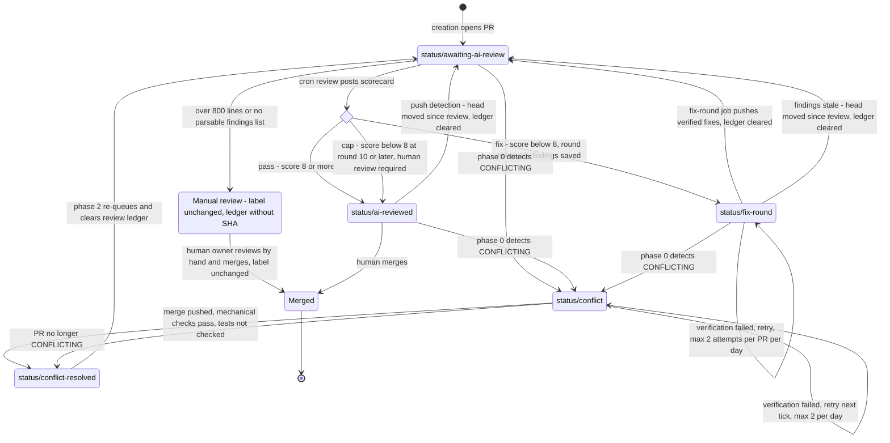

# Label States and Workflow

This is the label reference for the Software Factory pipeline described in
`blueprint/README.md`. It covers every label family, who owns each label,
and how the `status/*` labels move: which routine sets each label, which
routine removes it, and every transition with its trigger and guards.

How this file relates to the other label sources:

| Source | Holds |
|---|---|
| `docs/LABELS.md` | Canonical label names, colors, and descriptions, plus the `gh` bootstrap for a new repository. |
| `blueprint/LABELS.md` (this file) | The movement view: owners, routines, transitions, guards, and the lifecycle diagram. |
| `blueprint/README.md` | The pipeline as a whole. Section 3 summarizes the state machine; this file is the full reference. |
| `$H/.hermes/scripts/sdg-*.sh` | Ground truth. When a document and a script disagree, the script describes what actually happens. |

The two label documents must stay consistent: the same labels, colors, and
descriptions, and no transition here that the scripts do not perform. The
lifecycle diagram in section 5 is literally identical to the one in
`blueprint/README.md` section 3. Change one, change both, in the same pass
(see the change policy in section 9).

`$H` is the Hermes home on the host. State files named below live under
`$H/.autopr-sdg/`.

---

## 1. Families and ownership

| Family | Purpose | Owner | Set by |
|---|---|---|---|
| `status/*` | Automation lifecycle: where the automation stands with a PR | Bot | The cron routines only. People read these labels and do not set them. |
| `type/*` | What the change contains | Human or orchestrator | Assigned by hand or by a manually started session. The cron routines never set or read them. |
| `priority/*` | Urgency | Human or orchestrator | Assigned by hand. The cron routines never set or read them. |
| `quality/*` | Engine-and-effort contract: which models run the work, how hard they think, how many review rounds are expected | Human or orchestrator, with one automatic default | Creation stamps `quality/low` on every daily-stream PR. A person or the orchestrator upgrades it. No cron routine reads it. |

Unnamespaced GitHub defaults (`duplicate`, `question`, `invalid`,
`help wanted`, `good first issue`, `wontfix`) are kept as they are and play
no part in the pipeline.

Priority and quality are independent. Priority says how soon the work is
needed. Quality says how much firepower it deserves. An urgent typo fix is
`priority/urgent` and `quality/low`; a slow-burning process redesign can be
`priority/low` and `quality/high`.

## 2. `status/*` labels

All five are bot-owned.

| Label | Color | Description (live, matches `docs/LABELS.md` bootstrap) | Set by | Removed by |
|---|---|---|---|---|
| `status/awaiting-ai-review` | `FBCA04` | Bot-owned: PR created, queued for automated diff review (scorecard). Next: status/ai-reviewed. | Creation (new PR), review Phase 0 (push detection), fix rounds (verified push or stale findings), conflict repair Phase 2 | Review (any scored outcome) |
| `status/ai-reviewed` | `1D76DB` | Bot-owned: AI scorecard posted (verdict, mergeability, findings). Awaiting human merge decision. | Review (pass or cap) | Review Phase 0 (push detection), review (fix outcome) |
| `status/fix-round` | `A62D03` | Bot-owned: automation is working through AI review findings on this PR; one commit per finding. | Review (fix outcome) | Fix rounds (verified push or stale findings), review (pass or cap) |
| `status/conflict` | `D73A4A` | Bot-owned: merge conflict detected; automated resolution in progress (max 2 attempts/day). | Conflict repair Phase 0 | Conflict repair Phase 1 |
| `status/conflict-resolved` | `0E8A16` | Bot-owned: conflict auto-resolved, branch merged with base; re-queuing for AI review. | Conflict repair Phase 1 | Conflict repair Phase 2 |

`status/conflict-resolved` does not mean the tests passed. Conflict repair
checks that the push landed, that no conflict markers or attribution remain,
and that GitHub reports the PR as mergeable. It does not run the tests.

Two scripts can create a missing `status/*` label on the fly with a
different description: review for `status/ai-reviewed` ("AI-reviewed with
scorecard; awaiting human merge decision") and conflict repair for
`status/conflict-resolved` ("Conflict resolved by automation; ready for
review and merge"). On a repository bootstrapped from `docs/LABELS.md` the
labels exist and these fallbacks never run. They are a known drift from the
canonical descriptions.

## 3. Routines that move labels

| Routine | Schedule | Selects | Sets | Removes | State it writes |
|---|---|---|---|---|---|
| Creation, `sdg-autopr.sh` | `0,30 * * * *` | Due slots of the daily plan | `status/awaiting-ai-review`, `quality/low` on the new PR | Nothing | `run.log`, cooldown and breaker files |
| Conflict repair Phase 0, `sdg-conflict-patrol.sh` | `5,35 * * * *` | Open PRs assigned to the owner, `CONFLICTING`, without `status/conflict` or `status/conflict-resolved` | `status/conflict` | Nothing (the previous lifecycle label stays) | None |
| Conflict repair Phase 1 | same tick | PRs labeled `status/conflict` | `status/conflict-resolved` | `status/conflict` | `conflict-patrol/pr-<n>/{date,attempts}` |
| Conflict repair Phase 2 | same tick | PRs labeled `status/conflict-resolved` | `status/awaiting-ai-review` | `status/conflict-resolved` (a leftover lifecycle label stays) | Deletes `autoreview/done-<pr>`. Keeps `rounds-<pr>`. |
| Fix rounds, `sdg-fixround.sh` | `10,40 * * * *` | Open `auto-pr/*` PRs labeled `status/fix-round` without `status/conflict`, `status/conflict-resolved`, or `status/awaiting-ai-review`, that have a findings file | `status/awaiting-ai-review` | `status/fix-round` | Deletes `autoreview/done-<pr>`. Writes `autoreview/fixround/` counters, attempt ledgers, transcripts. |
| Review Phase 0 (push detection), `sdg-autoreview.sh` | `20,50 * * * *` | Open `auto-pr/*` PRs labeled `status/ai-reviewed` without any other lifecycle label, whose ledger records a head SHA different from the current head | `status/awaiting-ai-review` | `status/ai-reviewed` | Deletes `autoreview/done-<pr>` |
| Review main pass | same tick | Open `auto-pr/*` PRs labeled `status/awaiting-ai-review` | `status/ai-reviewed` or `status/fix-round` | `status/awaiting-ai-review`, plus `status/fix-round` (pass, cap) or `status/ai-reviewed` (fix) | `done-<pr>`, `rounds-<pr>`, `findings-<pr>.json`, `count-<date>` |
| Watchdog, `claude-watchdog.sh` | `25,55 * * * *` | Nothing | Nothing | Nothing | None |
| Human owner | any time | Any PR | `type/*`, `priority/*`, `quality/*`; merges or closes | `quality/low` when upgrading | May delete `rounds-<pr>` to grant a fresh round budget |

Every routine is idempotent. A label transition that fails is retried on
the next tick, and re-applying a transition that already happened changes
nothing. Re-queues change the label first and clear the ledger second, so a
tick that dies between the two leaves a PR the reviewer re-reviews anyway
(its ledger SHA no longer matches the head).

## 4. Transitions

Score gate defaults: pass at `SDG_REVIEW_PASS_SCORE` = 8, cap at
`SDG_REVIEW_MAX_ROUNDS` = 10. Score = 10, minus 2 per critical finding,
minus 1 per warning, floored at 0, counting only findings in files the PR
changed. The round number of a review is the number of lines in
`rounds-<pr>` plus one.

| # | From | To | Routine | Trigger | Guards | Side effects |
|---|---|---|---|---|---|---|
| T1 | (new PR) | `status/awaiting-ai-review` | Creation | A due slot of the daily plan; the engine opens the PR | Daily plan (3 to 10), 40-minute cooldown, window until 22:30, backlog gate (30 open), circuit breaker (3 failures), run lock and repo lock | `quality/low` stamped by the engine as instructed in the creation prompt; the script does not verify the labels |
| T2 | `status/awaiting-ai-review` | `status/ai-reviewed` | Review | Pass: score at least 8 | Kill switch `review-off`, run lock, 10 reviews per day, 2 per tick, 800-line cap, 60,000-character input cap, no ledger entry for the current head SHA | Scorecard comment, score appended to `rounds-<pr>`, `findings-<pr>.json` deleted, ledger `<date> <verdict> <score> <sha>` |
| T3 | `status/awaiting-ai-review` | `status/fix-round` | Review | Fix: score below 8 and round below 10 | As T2 | Scorecard comment ("automated fix round queued"), round appended, `findings-<pr>.json` written with findings, score, summary, round, threshold, and reviewed head SHA, ledger written |
| T4 | `status/awaiting-ai-review` | `status/ai-reviewed` | Review | Cap: score below 8 at round 10 or later | As T2 | Scorecard comment, plus a second comment "score-gate cap reached after N rounds ... human review required"; round appended, findings file deleted, ledger written |
| T5 | `status/awaiting-ai-review` | unchanged (manual review) | Review | Diff over 800 lines, or no engine (fallback included) returned a parsable findings list | As T2 | Ledger `<date> skipped-size` or `<date> failed`, with no SHA. No round consumed. The cron reviewer and push detection leave the PR alone from then on; the owner reviews it by hand. Unparseable output never counts as a pass. |
| T6 | `status/awaiting-ai-review` | outcome of T2, T3, or T4 | Review | The ledger already records the current head SHA: a tick died after the ledger write but before the label change | Same tick budgets | Label transition re-applied from the ledger score and `rounds-<pr>`. No second review, no new round. |
| T7 | `status/fix-round` | `status/awaiting-ai-review` | Fix rounds | Findings were recorded for the current head SHA, and the engine's fixes pass verification | Kill switch `fixround-off`, repo lock, 4 engine runs per day (counted at dispatch), 2 attempts per PR per day, 1 engine run per tick, mergeability neither `UNKNOWN` nor `CONFLICTING`, remote branch at the PR head. Verification: worktree on the branch, history not rewritten, no git operation in progress, no unmerged paths or conflict markers, leftovers committed by the script, clean tree, at least one new commit, no attribution in the message, author, or committer of any new commit, the orchestrator's own `npm test` passes, the PR is still open and still labeled `status/fix-round`, and the push is visible on the remote | Commits pushed by the script (the engine cannot push). Label changed first, then `done-<pr>` deleted. `rounds-<pr>` kept. |
| T8 | `status/fix-round` | `status/awaiting-ai-review` | Fix rounds | Stale findings: the reviewed head SHA in `findings-<pr>.json` differs from the PR head (a human push, or a tick that died after pushing) | Kill switch, repo lock. No engine run, so no budget is spent. | Label changed first, then `done-<pr>` deleted |
| T9 | `status/fix-round` | unchanged | Fix rounds | Engine reported failure, or any verification check failed | Attempt counted against both daily caps | Nothing pushed. A "failed verification" message. Retried on a later tick, at most twice per PR per day, every day, until it passes or a human acts. |
| T10 | `status/ai-reviewed` | `status/awaiting-ai-review` | Review Phase 0 (push detection) | The ledger records a head SHA and the PR head now differs from it | Kill switch, run lock. Skips PRs that also carry `status/fix-round`, `status/conflict`, `status/conflict-resolved`, or `status/awaiting-ai-review`, and ledger entries without a SHA. Runs before the daily budget check and spends no tokens. | Label changed first, then `done-<pr>` deleted. `rounds-<pr>` kept. |
| T11 | any open PR without `status/conflict` or `status/conflict-resolved` | adds `status/conflict` | Conflict repair Phase 0 | `mergeable` is `CONFLICTING` and the PR is assigned to the owner | Repo lock | The previous lifecycle label is not removed. Phase 0 does not filter on the head branch or on an existing `status/*` label, so an owner-assigned PR outside `auto-pr/*` enters the conflict loop too; after Phase 2 it carries `status/awaiting-ai-review`, which the reviewer ignores for non-`auto-pr/*` branches. |
| T12 | `status/conflict` | `status/conflict-resolved` | Conflict repair Phase 1 | A clean `git merge` of the base was pushed, or the engine resolved the conflict and pushed, and verification passed | Repo lock, 2 attempts per PR per day (clean merges count), `UNKNOWN` deferred. Verification: HEAD matches the remote, no attribution in the last commit, no conflict markers, GitHub reports neither `CONFLICTING` nor `UNKNOWN`. Tests are not checked. | PR comment describing the merge |
| T13 | `status/conflict` | `status/conflict-resolved` | Conflict repair Phase 1 | The PR is no longer `CONFLICTING` (and not `UNKNOWN`), for example because the base moved again | Repo lock | No push |
| T14 | `status/conflict` | unchanged | Conflict repair Phase 1 | Verification failed, the attempt cap was reached, or mergeability is `UNKNOWN` | 2 attempts per PR per day | Retried on a later tick or the next day |
| T15 | `status/conflict-resolved` | `status/awaiting-ai-review` | Conflict repair Phase 2 | Every PR labeled `status/conflict-resolved` | Repo lock | `done-<pr>` deleted, so the merged result is reviewed again. `rounds-<pr>` kept: a base merge is not new intent. A lifecycle label left from before the conflict stays until the next review transition removes it. |
| T16 | any | merged or closed | Human | Explicit human decision | Merge commits only (`gh pr merge --merge`), and only on explicit request | End of lifecycle |

## 5. Lifecycle diagram

This diagram is literally identical to the one in `blueprint/README.md`
section 3.



`Merged` is reachable from every state by explicit human action; the
diagram shows only the usual paths. A transition into `status/conflict`
adds that label next to the previous one (section 6).

## 6. Label hygiene and precedence

The review, push-detection, and fix-round transitions remove every lifecycle
label their target state excludes, so after them a PR carries exactly one
`status/*` label:

| Transition | Removes | Adds |
|---|---|---|
| Review, pass or cap (T2, T4, T6) | `status/awaiting-ai-review`, `status/fix-round` | `status/ai-reviewed` |
| Review, fix (T3, T6) | `status/awaiting-ai-review`, `status/ai-reviewed` | `status/fix-round` |
| Push detection (T10) | `status/ai-reviewed` | `status/awaiting-ai-review` |
| Fix round, verified or stale (T7, T8) | `status/fix-round` | `status/awaiting-ai-review` |

Conflict repair does not follow this rule yet. Phase 0 adds
`status/conflict` next to the existing lifecycle label (T11), and Phase 2
adds `status/awaiting-ai-review` without removing a leftover
`status/ai-reviewed` or `status/fix-round` (T15). The next review
transition cleans up. Until then, read the current state with this
precedence, which matches the exclusion filters the routines apply:

```
conflict > conflict-resolved > awaiting-ai-review > fix-round > ai-reviewed
```

For example, `status/fix-round` together with `status/awaiting-ai-review`
means "queued for review": the fix-round job skips the PR and the reviewer
picks it up. The reviewer does not exclude PRs that also carry
`status/conflict`, so a PR that starts conflicting while queued may be
reviewed once on its pre-merge code and again after Phase 2.

## 7. Budgets that bound the label loops

| Loop | Budget | Reset |
|---|---|---|
| Review and fix (T3, T7, back to T2 to T4) | `rounds-<pr>`: every scored review is one round. Below the gate at round 10 or later, the PR goes to the human (T4) instead of another fix round. At most 9 fix rounds per PR, ever. | Never by automation: not by a fix push, a conflict repair, or push detection. A human grants a fresh budget by deleting `rounds-<pr>`. |
| Fix-round attempts (T9) | 2 per PR per day, 4 engine runs per day, 1 per tick | Daily. A round that never verifies is retried every day until a human acts; this is bounded per day, not per lifetime. |
| Conflict repair (T12, T14) | 2 attempts per PR per day | Daily |
| Reviews (T2 to T6) | 10 per day, 2 per tick | Daily |

Kill switches: `touch $H/.autopr-sdg/review-off` stops review, including
push detection. `touch $H/.autopr-sdg/fixround-off` stops fix rounds; PRs
wait in `status/fix-round`. Creation and conflict repair are stopped by
disabling their cron entries.

## 8. Other families

### `type/*`

| Label | Color | Description |
|---|---|---|
| `type/bug` | `D73A4A` | Fixes incorrect behavior — something isn't working. |
| `type/feature` | `A2EEEF` | New feature or capability. |
| `type/docs` | `0075CA` | Documentation improvements or additions. |
| `type/tests` | `5319E7` | Test additions or improvements. |
| `type/refactor` | `FEF2C0` | Code restructuring with no behavior change. |
| `type/chore` | `EDEDED` | Maintenance — deps, tooling, config, CI. |
| `type/security` | `B60205` | Security-related fix or hardening. |

Owner: human or orchestrator. No routine sets, removes, or reads them.

### `priority/*`

| Label | Color | Description |
|---|---|---|
| `priority/urgent` | `B60205` | Drop everything — blocks release or a client. |
| `priority/high` | `D93F0B` | Important — should make the next release. |
| `priority/medium` | `FBCA04` | Normal queue. |
| `priority/low` | `C2E0C6` | Nice to have — pick up when free. |

Owner: human. No routine sets, removes, or reads them.

### `quality/*`: the engine-and-effort contract

| Label | Color | Description | Contract |
|---|---|---|---|
| `quality/low` | `C2E0C6` | Routine automated change; single-pass review, standard score gate. Default for daily PR stream. | The cron path as it runs today: Opus implements, diff-scoped review (Haiku up to 400 lines, standard Sol up to 800), score gate at 8, automated fix rounds. No owner turnaround expected before the merge decision. |
| `quality/mid` | `FBBC04` | Meaningful change; full-strength review model regardless of diff size. | Closer attention: a full-strength review model whatever the diff size, and an owner look before merge. |
| `quality/high` | `5319E7` | Architectural or high-stakes; top model + max effort, multi-round score-gated loop. | Architectural, process, or high-stakes work. The orchestrator assigns Opus with `ultrathink` to implement and GPT-6.1-Sol at `#xhigh` effort to review, runs a multi-round score-gated fix loop, and expects explicit back-and-forth with the owner. The label exists to support the owner's decision. |

Owner: human or orchestrator. Creation stamps `quality/low` on every
daily-stream PR through its prompt; a person or the orchestrator upgrades
the label when the work turns out to be architectural.

What enforces the contract today:

- **No cron routine reads `quality/*`.** Review routes by diff size only,
  so the `quality/mid` promise of a full-strength model regardless of size
  is not implemented by `sdg-autoreview.sh`. Mid and high obligations are
  carried out by the orchestrator, a person or a manually started session.
- **Cron does not skip higher tiers.** A `quality/mid` or `quality/high` PR
  on an `auto-pr/*` branch is still picked up by the cron reviewer and the
  fix-round job with their standard engines. The orchestrator's tier
  obligations come on top of the cron path, not instead of it.
- **`quality/low` stamping is an engine instruction.** The creation script
  does not verify that the label was applied, and the `create-pr` skill
  does not add it.

Obligations of the orchestrator for `quality/high`:

1. Implement with Opus at `ultrathink` effort, in its own worktree.
2. Review with GPT-6.1-Sol at `#xhigh` effort, not with the cron reviewer's
   diff-size routing.
3. Run a score-gated loop: fix, re-review, until the score reaches the gate
   or the round budget is spent. The same lifetime-budget rule applies: the
   orchestrator does not reset its own round count.
4. Bring the owner into the loop with the findings, the score progression,
   and the open trade-offs, and wait for the owner's decisions rather than
   resolving them alone.
5. Leave the merge to the owner, as for every other PR.

## 9. Change policy

The label scheme is part of one contract with `docs/LABELS.md`, this file,
`blueprint/README.md`, the GitHub labels themselves, the pipeline scripts
(`sdg-autopr.sh`, `sdg-autoreview.sh`, `sdg-fixround.sh`,
`sdg-conflict-patrol.sh`), `.claude/skills/create-pr/SKILL.md`, and the
runbook. It changes only on explicit request from the repository owner, and
then in one pass across all of them. In particular:

- A new or renamed label appears in `docs/LABELS.md` (description and
  bootstrap) and in this file (owner and movement) in the same change.
- A new transition appears in the transition table here, in
  `blueprint/README.md` section 3, and in both copies of the lifecycle
  diagram, which stay literally identical.
- When this file and a script disagree, the script describes what the
  pipeline does. Fix whichever is wrong, in the same pass.
