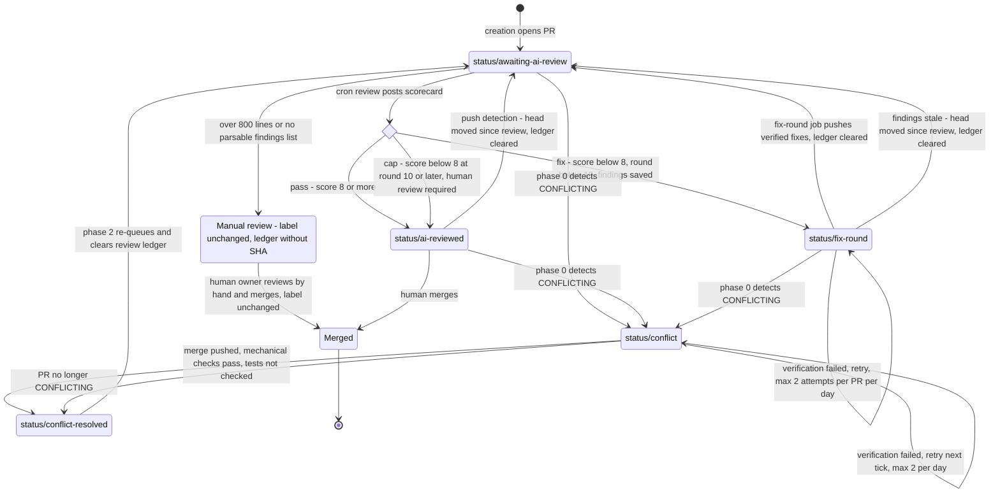
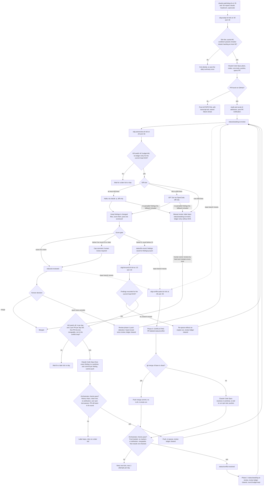

# Software Factory Blueprint

This document describes the autonomous pull-request pipeline that runs around
this repository, and how to reuse it on another project. It covers design,
guards, and lessons learned. It does not describe the `sure-daily-github`
product itself; for that, see the repository `README.md` and `docs/`.

Related sources:

| Source | Role |
|---|---|
| `$H/.hermes/scripts/sdg-*.sh`, `claude-watchdog.sh` | The pipeline. Ground truth when this document and the code disagree. |
| `$H/.hermes/skills/devops/auto-pr-pipeline/SKILL.md` | Operational runbook: manual procedures, pitfalls, recovery steps. |
| `docs/LABELS.md` | Canonical label scheme: names, colors, descriptions, and `gh` bootstrap commands. |
| `blueprint/LABELS.md` | Label states and workflow: owner of every label in all four families, which routine sets and removes each `status/*` label, the full transition table with triggers and guards, and the `quality/*` contract. |
| `.claude/skills/create-pr/SKILL.md` | Branch name, PR title and PR description template. |

`$H` is the Hermes home on the host (`/home/gerwin/.local/share/hermes-vps`).
All times are Asia/Manila (PHT).

---

## 1. What this is

### Definition

In this document, a **software factory** is a pipeline in which code changes
are created, reviewed, repaired, and re-reviewed by automation, and a person
makes only the merge decision:

```
create -> review -> self-heal -> re-review -> human merge
```

### Fit assessment

The pipeline is a working proof of concept of that definition. It has run
unattended on a schedule since 2026-10-14. As of 2026-10-25, the creation
log records 73 successful creation cycles.

What earns the term:

- **Unattended production.** Cron produces 3 to 10 pull requests a day.
  Each PR is planned, implemented, tested, pushed, and opened by an engine
  without a person starting it.
- **Uniform output.** Branch names, PR titles, PR description sections, and
  labels follow fixed templates. Every PR has the same shape and can be
  processed by the next stage without special cases.
- **Closed repair loops for the two most common failures.** When a PR stops
  merging cleanly because its base branch moved, the pipeline detects it,
  repairs it, runs mechanical checks on the pushed result, and sends it back
  for another review. Those checks do not include the test suite (see the
  conflict test gate limit below). When a review scores a PR below the
  score gate (8 of 10), a fix-round job addresses the findings, runs the
  test suite itself, pushes only if it passes, and sends the PR back for
  another review, up to a per-PR lifetime round budget. No person is
  involved in either loop.
- **Throttles on every producer.** A daily plan, a cooldown, a backlog gate,
  a circuit breaker, review budgets, and fix-round budgets keep output and
  spending bounded.
- **Toolchain self-maintenance.** A watchdog repairs the engine toolchain
  after host updates remove it.

What is still proof-of-concept grade:

| Limit | Detail |
|---|---|
| Single repository | Every script hardcodes one repository slug, one local clone, and one worktree path per job (conflict repair, fix rounds). |
| Single assignee | The conflict checker selects PRs assigned to one user. The creation prompt assigns every PR to that user. Review and fix rounds select by head branch (`auto-pr/*`), not by assignee. |
| Hardcoded names | Host paths, the repository, the assignee, the commit identity for script-made commits, the base branch for creation (`master`), and the proxy port are literals. A few values have environment overrides. |
| GitHub-specific | State lives in GitHub labels and comments. Detection relies on GitHub's `mergeable` field. All I/O goes through the `gh` CLI. |
| Human merge gate | This is intentional. It also caps throughput at the owner's review bandwidth, which is why the backlog gate exists. |
| Conflict test gate is not enforced by the script | A clean merge is pushed without running the test suite. A conflicted merge depends on the engine following its instruction to run `npm test`. The orchestrator verifies that the push landed, that no conflict markers or attribution remain, and that GitHub reports the PR as mergeable. It does not run the tests or check their results. The live `status/conflict-resolved` label description, the PR comment, and the bootstrap snippet in section 6 claim only what is verified ("branch merged with base"). Two places still overstate it: the patrol's channel notification ("conflict auto-resolved, tests green") and the `status/conflict-resolved` row of the status table in `docs/LABELS.md` ("test suite green"). |
| Review gates automation, not merging | Findings are filtered to files the PR changed. They are not checked line by line, and the reviewer does not run the tests. The score decides only whether the automation runs another fix round. It never merges and never blocks the owner from merging. |
| Status labels can still coexist during conflict repair | The review, push-detection, and fix-round transitions remove stale lifecycle labels. Conflict repair does not: Phase 0 adds `status/conflict` next to whatever lifecycle label the PR carries, and Phase 2 adds `status/awaiting-ai-review` without removing it. The next review transition cleans up. Section 3 defines the precedence rule for reading coexisting labels. |
| Fix-round retries are bounded per day, not per lifetime | The per-PR round budget bounds how many reviews can send a PR into a fix round. A fix round that keeps failing verification is retried at most twice per PR per day, but on every day until it passes or a human acts. |
| CI is not consulted | No stage reads GitHub check runs. |
| Partial kill switches | Review and fix rounds have marker-file kill switches. Creation and conflict repair are stopped by disabling their cron entries. |
| Pipeline scripts have no test suite | Script changes are checked with hand-run fixtures. |
| Observability | Observability is limited to channel messages and per-script log files. There are no metrics. A PR stuck in a deferred state (5.8) produces no notification. |

What separates it from production:

1. **An enforced test gate on every push path.** The fix-round job already
   has one: it runs `npm test` itself and pushes only if it passes. Creation
   and conflict repair do not. The product's own `fix-conflicts` command
   (`docs/CONFLICT_FIXER.md`) shows the pattern for conflict repair: it
   pushes only after the repository's tests pass, in an isolated clone, and
   never force-pushes.
2. **CI as the source of truth** for merge readiness, instead of an engine's
   report.
3. **One lifecycle label at a time, enforced by the orchestrator on every
   transition.** Review, push detection, and fix rounds already remove stale
   lifecycle labels; conflict repair does not yet. The product's `pr-maint`
   command (`docs/PR_MAINTENANCE.md`) removes extra
   lifecycle labels and has a per-PR and global `automation-paused` kill
   switch. It uses its own `sdg:*` label namespace and is not yet wired into
   this pipeline.
4. **Configuration instead of literals**, so that more than one repository,
   assignee, or base branch can be supported.
5. **Tests for the pipeline itself**: fixture tests for every parse chain and
   for every state transition.
6. **Metrics**: PRs per day, review score distribution, conflict repair
   success rate, the rate at which the human overrides the review verdict,
   and time from creation to merge.
7. **An automated merge policy**, if it is ever wanted. The human gate is a
   deliberate choice in this pipeline, not a missing feature.

---

## 2. Architecture

### Jobs

The pipeline consists of five cron entries in the Hermes scheduler. All five
run as `no_agent` jobs: Hermes runs the script directly and delivers its
standard output to the configured destination.

| Schedule | Script | Purpose | Engine | Guards | Delivers to |
|---|---|---|---|---|---|
| `0,30 * * * *` | `sdg-autopr.sh` | Creates one PR per due slot. Claude Code plans, codes, tests, branches, commits, pushes, and opens the PR with labels `status/awaiting-ai-review` and `quality/low`. The script then checks the result and posts the notification. | Claude Code, `claude-opus-5-5`, under `headroom wrap` | Deterministic daily plan (3 to 10 PRs), 40-minute cooldown, catch-up window closes at 22:30, backlog gate (more than 30 open `auto-pr/*` PRs pauses creation), circuit breaker (3 consecutive failed cycles stops creation for the day), 60 turns, 30-minute timeout, run lock and repo lock, attribution audit after the cycle | Review channel |
| `5,35 * * * *` | `sdg-conflict-patrol.sh` | Phase 0 labels conflicting PRs. Phase 1 resolves them. Phase 2 sends resolved PRs back for review. | `git merge` when the merge is clean. Otherwise Claude Code, `claude-opus-5-5`, under `headroom wrap`. | 2 attempts per PR per day, `UNKNOWN` mergeability deferred to the next tick, repo lock, orchestrator verification, 40 turns, 25-minute timeout | Review channel |
| `10,40 * * * *` | `sdg-fixround.sh` | Takes at most one `status/fix-round` PR per tick. Claude Code addresses every finding in `findings-<pr>.json` in a dedicated worktree, one commit per finding, and does not push. The script verifies the result, runs `npm test` itself, pushes only if the tests pass, then changes the label to `status/awaiting-ai-review` and clears the review ledger. Findings whose reviewed head SHA no longer matches the PR head are stale: the PR is re-queued for review without an engine run. | Claude Code, `claude-opus-5-5`, called directly (no `headroom wrap`). `git push` is disallowed for the engine. | 4 engine runs per day (counted at dispatch), 2 attempts per PR per day, 1 engine run per tick, repo lock, `UNKNOWN` mergeability deferred, `CONFLICTING` PRs left to conflict repair, PRs also carrying another in-flight `status/*` label skipped, 40 turns, 25-minute timeout, 10-minute orchestrator test run, kill switch | Review channel |
| `20,50 * * * *` | `sdg-autoreview.sh` | Phase 0 (push detection) re-queues `status/ai-reviewed` PRs whose head moved since their review. Then reviews each PR labeled `status/awaiting-ai-review` on an `auto-pr/*` branch, posts one scorecard comment, and applies the score gate: 8 or more goes to `status/ai-reviewed`; below 8 goes to `status/fix-round` with the findings saved; below 8 at round 10 goes to `status/ai-reviewed` with a "human review required" comment. | `claude-haiku-5-5` (`claude -p`) for diffs of 400 lines or fewer. `openai/gpt-6.1-sol` (OpenCode) for 401 to 800 lines. | One review per code state (the ledger records the reviewed head SHA), 10 reviews per day, 2 per tick, diffs over 800 lines skipped, 60,000-character input cap, per-PR lifetime round budget, kill switch, run lock | Review channel |
| `25,55 * * * *` | `claude-watchdog.sh` | Repairs the toolchain: the node symlink, the `claude` CLI (reinstall, plus an update check at most every 20 hours), `headroom` with its proxy extras and launcher, and the `opencode` symlink. | None. Uses no tokens. | Silent when healthy | Owner's direct messages |

The jobs are staggered so that they rarely overlap. The watchdog runs five
minutes before each creation tick, so a broken toolchain is repaired before
the job that relies on it most. The fix-round job runs ten minutes before
each review tick: a fix round that finishes within ten minutes is
re-reviewed in the same half-hour, and a longer one at the next review
tick. Creation, conflict repair, and fix rounds share the repo lock
(below), so a long run of one makes the others skip their ticks.

### Score gate and round budget

The review computes a score from the findings it keeps: 10, minus 2 per
critical finding, minus 1 per warning, floored at 0. Suggestions do not
lower it. Every scored review appends its score to `rounds-<pr>`, so the
round number of a review is the count of earlier scored reviews plus one.

| Outcome | Condition | Label after the review | Side effects |
|---|---|---|---|
| Pass | Score at least `SDG_REVIEW_PASS_SCORE` (8) | `status/ai-reviewed` | `findings-<pr>.json` deleted |
| Fix | Score below 8 and round below `SDG_REVIEW_MAX_ROUNDS` (10) | `status/fix-round` | Findings, score, summary, round, and reviewed head SHA saved to `findings-<pr>.json` for the fix-round job |
| Cap | Score below 8 at round 10 or later | `status/ai-reviewed` | A second comment: "score-gate cap reached ... human review required" |

An engine output without a parsable findings list is a failed review, not a
pass. It takes the manual-review path (section 3). An earlier version scored
such output as "approve, 10/10".

The round budget is a per-PR lifetime budget. Automation never resets
`rounds-<pr>`: not on a fix-round push (the fix rounds are the loop being
bounded), not on a conflict repair (a mechanical base merge is not new
intent, and resetting would let a churning base branch reopen the loop
indefinitely), and not on push detection. Passing reviews and conflict
re-reviews also consume rounds. So at most 9 reviews per PR can ever send it
into a fix round. After the cap, each new code state still gets one review,
but a low score no longer re-enters the loop. Only a human grants a fresh
budget, by deleting `rounds-<pr>`.

### Engine routing

| Role | Engine and model | Input | Cost basis |
|---|---|---|---|
| Implementation | Claude Code, `claude-opus-5-5` | The whole repository. The engine explores, edits, and runs tests. | Subscription |
| Conflict resolution | Claude Code, `claude-opus-5-5` | Worktree with a merge in progress | Subscription. Runs only when `git merge` cannot finish on its own. |
| Fix round | Claude Code, `claude-opus-5-5`, 40 turns | Worktree on the PR branch, plus the saved findings JSON (up to 20,000 characters). The engine explores, edits, commits, and runs tests, but cannot push. | Subscription. Runs only for a PR the score gate sent to `status/fix-round`. |
| Review, 400 diff lines or fewer | `claude -p`, `claude-haiku-5-5`, 4 turns, `Read` tool only | The diff and the PR title and body only | Subscription, so no per-token cost |
| Review, 401 to 800 diff lines | OpenCode, `openai/gpt-6.1-sol` | The diff and the PR title and body only | Metered: $2 per million input tokens and $10 per million output tokens |
| Review fallback | `claude -p`: Haiku for 400 lines or fewer, Opus for more | Same | Subscription |
| Review, more than 800 diff lines | None. The PR is skipped with a note. | None | None |

The routing follows from where open-ended reasoning is needed:

- **Implementation is unbounded.** The engine has to choose a change, read the
  code, edit several files, and get the tests to pass. The strongest model is
  used here, and the run is capped by turns and wall-clock time.
- **Review is bounded by the diff.** For a small diff, a small model with no
  repository access is enough to find correctness, edge-case, security, and
  missing-test issues.
- **Large diffs go to a stronger metered model**, under a line cap and a
  character cap. The caps bound the input of one review, not its total cost.
  An illustrative estimate for one successful metered review: at about
  4 characters per token, 60,000 characters of diff plus a 3,000-character
  description is roughly 16,000 input tokens, or about $0.03. A typical
  output is a JSON findings list of a few thousand tokens, or a few cents.
  Ten such reviews a day come to well under $1. This is an estimate, not a
  measured bill, and not a bound: the daily and per-tick counters count only
  successful reviews, a failed metered attempt is still billed, and nothing
  caps the engine's output tokens. A hard daily bound would require counting
  attempts rather than successes against the budget, and capping output
  tokens or spend on the metered engine. The score gate does not raise this
  estimate: fix-round re-reviews draw on the same 10-per-day budget.
- **Fixing is unbounded again.** Addressing a finding means reading code
  beyond the diff, editing, and getting the tests to pass, so fix rounds use
  the implementation model with repository access, not the review models.
  They run on the subscription and are capped at 4 runs a day.
- **Speed tiers are never used** (`-fast`, `-ultrafast`). They cost more per
  token, not less (see incident 5.5). Batch review has no latency requirement.
- **A fallback must reset the model ID.** If the OpenCode run fails, the
  Claude fallback picks a Claude model. It never passes an OpenAI model ID to
  the Claude CLI.

The creation and conflict-repair Claude Code launches go through
`headroom wrap`, a context-compression proxy, on a dedicated port
(`HEADROOM_PORT=8789`). The fix-round job calls `claude -p` directly,
without the proxy. Where the proxy is used, the port must be set on every
launch. The proxy process is stopped after each run, because a leftover
proxy holds about 700 MB of memory.

### Quality tiers

`quality/*` labels set the engine-and-effort contract for a PR: which models
run the work, how hard they think, and how many review rounds are expected.
They are independent of `priority/*`, which sets urgency only. The labels
and their contracts are defined in `docs/LABELS.md`; `blueprint/LABELS.md`
section 8 describes who sets them and what enforces them.

| Tier | Who sets it | Contract |
|---|---|---|
| `quality/low` | Creation, on every daily-stream PR (an instruction in the creation prompt, not verified by the script) | The cron path in this document: Opus implements, diff-scoped review routed by size, score gate at 8, automated fix rounds. |
| `quality/mid` | A person or the orchestrator, by upgrading | A full-strength review model regardless of diff size, and an owner look before merge. |
| `quality/high` | A person or the orchestrator, for architectural or process work | The orchestrator implements with Opus at `ultrathink` effort, reviews with GPT-6.1-Sol at `#xhigh` effort, runs a multi-round score-gated fix loop, and works through the findings and trade-offs with the owner before the merge decision. |

No cron job reads `quality/*` today. Review still routes by diff size, and a
higher-tier PR on an `auto-pr/*` branch still goes through the cron review
and fix rounds. The mid and high obligations are carried out by the
orchestrator on top of the cron path, under the same rules as the cron
loop: a round budget it does not reset itself, and a human merge.

### Concurrency and isolation

| Lock | Held by | Protects |
|---|---|---|
| `$H/.autopr-sdg/lock` | Creation | Prevents two creation cycles from running at once. |
| `$H/.autopr-sdg/repo.lock` | Creation, conflict repair, and fix rounds | The shared clone. Creation runs `git checkout master` and `git reset --hard origin/master` in it. Conflict repair and fix rounds add and remove linked worktrees from it. A fix round holds the lock for its whole run: up to 25 minutes of engine time plus `npm ci` and an orchestrator test run of up to 10 minutes. |
| `$H/.autopr-sdg/autoreview/lock` | Review | Prevents two review ticks from running at once. Review never touches a checkout (it uses `gh` only), so it does not take the repo lock. |

All locks are non-blocking (`flock -n`). A busy lock makes the tick exit and
leaves the work to the next tick. It never queues behind the other job.

Worktree isolation:

- **Conflict repair** creates a dedicated linked worktree for each PR it
  processes and removes it afterwards. A fresh worktree has no `node_modules`,
  so the script runs `npm ci` before any tests.
- **Fix rounds** do the same in their own linked worktree
  (`wt-fixround`), one PR at a time.
- **Creation** works in the primary clone after a hard reset to
  `origin/master`. The repo lock keeps it from interfering with conflict
  repair and fix rounds.
- **Manually started jobs** (feature implementation, manual review and fix
  sessions, documentation) each get their own worktree on their own branch.
  They never share a checkout with each other or with the cron jobs.

### State on disk

| Path under `$H/.autopr-sdg/` | Meaning |
|---|---|
| `run.log` | Creation log. Its `ok:` lines are the authoritative daily quota count. |
| `last_pr_ts` | Time of the last successful PR. Used for the cooldown. |
| `daydone-<date>` | The daily summary has been posted for this date. |
| `fail_streak`, `fail_day`, `circuit-<date>` | Circuit breaker state. |
| `claude-<date>-<idx>.txt`, `fixconf-<pr>-<ts>.txt` | Engine transcripts for each cycle. Deleted after 14 days. |
| `autoreview/done-<pr>` | Review ledger: `<date> <verdict> <score> <head SHA>`. One review per code state: the reviewer skips the PR while the recorded SHA equals the PR head, and push detection re-queues it when they differ. Two-word verdicts are stored hyphenated (`request-changes`). Entries without a SHA (`<date> failed`, `<date> skipped-size`, and legacy three-field entries) mean "manual from here": they are never re-queued by push detection. A legacy entry is upgraded on the PR's next review. |
| `autoreview/rounds-<pr>` | One score per line, one line per scored review. The per-PR lifetime round budget. Never deleted by automation. |
| `autoreview/findings-<pr>.json` | Findings, score, summary, round, threshold, and reviewed head SHA of the last below-gate review. Written on a fix outcome, deleted on a pass or cap. Read by the fix-round job. |
| `autoreview/count-<date>` | Number of successful reviews that day. |
| `autoreview/fixround/count-<date>` | Fix-round engine runs that day, counted at dispatch. |
| `autoreview/fixround/pr-<n>/{date,attempts}` | Fix-round attempts per PR per day. |
| `autoreview/fixround/claude-<pr>-<ts>.txt`, `test-<pr>.txt`, `fixround.log` | Fix-round transcripts, orchestrator test output, and log. Transcripts, test output, and counters are deleted after 14 days. |
| `conflict-patrol/pr-<n>/{date,attempts}` | Conflict-repair attempts per PR per day. |
| `review-off` | Review kill switch. Review is disabled while this file exists. |
| `fixround-off` | Fix-round kill switch. Fix rounds are disabled while this file exists. |

### Notification design

Hermes delivers whatever a `no_agent` script prints to standard output, and
delivers nothing when the output is empty. The pipeline builds on that:

- **One message per unit of work.** Units of work are: a PR created, a PR
  reviewed (including its score-gate outcome), a PR re-queued by push
  detection, a fix round pushed or failed, a conflict-label transition, a
  failed cycle, a toolchain repair, and the daily summary.
- **Standard output is the only delivery path.** A script never sends to a
  channel itself. Two paths to the same channel caused every message to be
  posted twice (incident 5.1).
- **Idle ticks print nothing.** Nothing printed means nothing delivered.
- **Silence is made unambiguous.** Because an idle tick and a dead job look
  the same, creation posts exactly one summary per day: "day complete" when
  the plan is done, or "day ended short" when the window closes before the
  plan is done. The summary includes the backlog and the next day's plan.
- **A failure message carries the cause.** It includes the last few lines of
  the engine transcript, not only a log path, so diagnosing it does not
  require a shell session on the host.

---

## 3. The PR state machine

State is held in `status/*` labels on the PR. `docs/LABELS.md` holds their
canonical descriptions; `blueprint/LABELS.md` is the label-workflow
reference, with every transition, its trigger, its guards, and the routine
that performs it. This section is the summary. The `status/*` labels are
owned by the automation. People read them and do not set them.
They describe where the automation stands with a PR, not whether the PR may
be merged.

### States

| State (label) | Set by | Entry condition | Exit transitions | Guards |
|---|---|---|---|---|
| `status/awaiting-ai-review` | Creation, fix rounds, push detection, conflict repair Phase 2 | Creation opens the PR with this label. A fix round re-queues the PR after a verified push, or when its findings are stale. Push detection re-queues a reviewed PR whose head moved. Phase 2 re-queues a PR after a conflict repair. Every re-queue clears the review ledger `done-<pr>`. | The cron review posts a scorecard and applies the score gate (section 2): pass goes to `status/ai-reviewed`, fix goes to `status/fix-round`, cap goes to `status/ai-reviewed` with a "human review required" comment. A diff over 800 lines (`skipped-size`) or an engine output without a parsable findings list (`failed`) leaves the label in place with a ledger entry and no SHA: manual review. If the ledger already records the current head SHA (a tick died after writing it), the label transition is re-applied from the ledger and the PR is not reviewed again. Phase 0 of conflict repair adds `status/conflict`. | Ledger `done-<pr>`, 10 per day, 2 per tick, 800-line cap, 60,000-character cap, kill switch. Only `auto-pr/*` head branches are picked up. The reviewer does not exclude PRs that also carry `status/conflict`. |
| `status/ai-reviewed` | Review | The review posted its scorecard, and the score passed the gate or the round budget was exhausted. | Human merges, which ends the lifecycle. Push detection (review Phase 0) sees a head SHA different from the one in the ledger and moves the PR to `status/awaiting-ai-review`, clearing the ledger. Phase 0 of conflict repair sees `CONFLICTING` and adds `status/conflict`. | Human merge gate. No automated exit to merged. Push detection skips PRs that also carry `status/fix-round`, `status/conflict`, `status/conflict-resolved`, or `status/awaiting-ai-review`, and PRs whose ledger entry has no SHA. |
| `status/fix-round` | Review (score gate, fix outcome) | The review scored the PR below 8 at a round below 10 and saved the findings to `findings-<pr>.json`. | The fix-round job addresses the findings, passes verification, pushes, and moves the PR to `status/awaiting-ai-review`, clearing the ledger. If the findings were recorded for a head SHA that is no longer the PR head, the job re-queues the PR the same way without an engine run. When verification fails, the label stays and the job retries on a later tick. Phase 0 of conflict repair adds `status/conflict`. | 4 engine runs per day, 2 attempts per PR per day, 1 per tick, repo lock, kill switch. Skips PRs that also carry `status/conflict`, `status/conflict-resolved`, or `status/awaiting-ai-review`, PRs whose mergeability is `UNKNOWN` or `CONFLICTING`, and PRs with no findings file. Verification before the push: branch and history intact, no merge or rebase in progress, clean tree, no conflict markers, no attribution in any new commit, the orchestrator's own `npm test` passes, and the PR is still open and still labeled `status/fix-round`. |
| `status/conflict` | Conflict repair | Phase 0: the PR is open, assigned to the owner, `mergeable` is `CONFLICTING`, and it has neither `status/conflict` nor `status/conflict-resolved`. Phase 0 adds the label without removing the PR's other lifecycle label. | Becomes `status/conflict-resolved` once a repair passes verification, or once the PR is found to be no longer `CONFLICTING`. Stays when verification fails, until the next tick. Stays when the attempt cap is reached, until the next day or a human acts. | 2 attempts per PR per day (clean merges count as attempts), `UNKNOWN` deferred, repo lock, verification: push landed, no attribution in the last commit, no conflict markers, GitHub reports neither `CONFLICTING` nor `UNKNOWN`. |
| `status/conflict-resolved` | Conflict repair | Phase 1 succeeded: the branch was merged with its base and passed the mechanical checks listed above, or the PR stopped conflicting on its own. The label does not mean the tests passed. | Phase 2 replaces it with `status/awaiting-ai-review` and deletes `autoreview/done-<pr>`, so the merged result gets reviewed again. Phase 2 does not remove a lifecycle label left over from before the conflict; the next review transition does. | Phase 0 skips PRs with this label, so they cannot be relabeled in a loop. The round budget is not reset. |
| Merged or closed | Human | Explicit human action | None (end of lifecycle) | Merge commits only (`gh pr merge --merge`). Merges happen only on explicit request. |

**Label hygiene.** The review, push-detection, and fix-round transitions
remove every lifecycle label the target state excludes: a pass or cap
removes `status/awaiting-ai-review` and `status/fix-round`, a fix outcome
removes `status/awaiting-ai-review` and `status/ai-reviewed`, push detection
removes `status/ai-reviewed`, and a fix round removes `status/fix-round`.
Each transition is idempotent, so re-applying it after a lost tick is safe.
Conflict repair is the exception: Phase 0 adds `status/conflict` next to the
existing lifecycle label, and Phase 2 adds `status/awaiting-ai-review`
without removing it. A PR can therefore carry two `status/*` labels during
and just after a conflict repair, for example `status/ai-reviewed` and
`status/conflict`. Read the current state with this precedence, which matches
the exclusion filters the jobs apply:

```
conflict > conflict-resolved > awaiting-ai-review > fix-round > ai-reviewed
```

**Merge permission.** Lifecycle labels reflect automation state, not merge
permission. The human owner may merge any PR at any time, whatever its
labels say. `status/ai-reviewed` as the sole `status/*` label means only
that the automation has finished with the PR in its current code state and
posted a scorecard. After a cap, the scorecard says so, and the PR needs a
human review before any merge.

**Manual review.** When the cron reviewer skips a PR (diff over 800 lines)
or gets no parsable findings list from any engine, it writes a ledger entry
without a SHA and leaves the label at `status/awaiting-ai-review`. The owner
reviews the PR by hand and merges it, or not, without changing the label.
The ledger entry blocks only the cron reviewer and push detection from
picking the PR up again. Nothing else reads it: conflict repair, merging,
and manual sessions ignore it. If the PR later conflicts, conflict repair
Phase 2 deletes the entry as usual, and the cron reviewer tries again on the
merged result.

**Further changes on a reviewed PR.** When the owner wants more changes on a
`status/ai-reviewed` PR, the owner or a manually started session pushes
commits to the PR branch. Push detection re-queues the PR on the next review
tick, and the score gate applies again, using rounds from the same lifetime
budget. A manual session does not set `status/*` labels by hand. In
particular, a hand-set `status/fix-round` without a findings file is
ignored by the fix-round job and excluded from push detection, so nothing
would ever clear it.

### Label lifecycle

This diagram is literally identical to the one in `blueprint/LABELS.md`
section 5.



`Merged` is reachable from every state by explicit human action; the
diagram shows only the usual paths. A transition into `status/conflict`
adds that label next to the previous one, as described under label hygiene.

### Factory pipeline



---

## 4. Token frugality

**Principle: automation multiplies tokens. Every automated path needs a
budget and an off switch.** A manual prompt costs tokens once. A cron entry
that runs every 30 minutes can spend them 48 times a day, indefinitely, and
a bug in a loop spends them faster. Each stage of the pipeline therefore
bounds the cost of a single run, the number of runs, and the total, and has
a way to be stopped.

| Control | Stage | Mechanism | Effect |
|---|---|---|---|
| Diff-scoped input | Review | The engine receives only the PR title, up to 3,000 characters of description, and the diff. It runs in an empty temporary directory with the `Read` tool only. | Review cost depends on the diff size, not the repository size. |
| Input cap | Review | Diff truncated to 60,000 characters. Null bytes stripped. | Bounds the input of a single review. |
| Line cap | Review | Diffs over 800 lines are skipped with a note. | The most expensive reviews go to the human. |
| Model routing | Review | Haiku (subscription) for 400 lines or fewer. Standard Sol (metered) for larger diffs. Never a speed tier. | Most reviews have no per-token cost. |
| One review per code state | Review | `done-<pr>` records the reviewed head SHA. It is written after a review, a size skip, or an engine failure. It is cleared by a fix-round push, a stale-findings re-queue, push detection, or a conflict repair. | The cron reviewer reviews each code state of a PR once, not once per tick. A size skip or engine failure writes no SHA, so that PR is never re-reviewed automatically until a conflict repair clears the entry. |
| Daily and tick budgets | Review | 10 successful reviews per day, 2 per tick. | Limits successful reviews per day and per tick. Failed attempts are not counted (see known gaps). Fix-round re-reviews draw on the same budget. |
| Per-PR lifetime round budget | Review, fix rounds | Every scored review appends to `rounds-<pr>`. Below the gate at round 10 or later, the PR goes to the human instead of another fix round. Automation never resets the file. | At most 9 fix rounds per PR, ever. A PR that cannot reach the gate costs a bounded number of fix runs and then waits for the owner. |
| Kill switch | Review | `touch $H/.autopr-sdg/review-off` disables review. `rm` re-enables it. | Immediate stop without editing cron. |
| Fix-round budgets | Fix rounds | 4 engine runs per day, counted at dispatch so failed runs count. 2 attempts per PR per day. 1 engine run per tick. | At most 4 Opus fix runs a day, and a single PR cannot take more than 2 of them. |
| Repo lock hold | Fix rounds | A fix round holds `repo.lock` for up to about 25 minutes of engine time plus `npm ci` and a test run of up to 10 minutes. | Creation and conflict repair skip their ticks while it runs, which also bounds how much of the day fix rounds can occupy. |
| Fix-round kill switch | Fix rounds | `touch $H/.autopr-sdg/fixround-off` disables fix rounds. `rm` re-enables them. | PRs stay in `status/fix-round` until it is removed. Nothing else is affected. |
| Test gate | Fix rounds | The orchestrator runs `npm test` itself and pushes only if it passes. The engine's `TEST_SUMMARY` line is required but not trusted. | A fix that breaks the suite is never pushed, so it never spends a review on broken code. |
| Daily plan | Creation | 3 to 10 PRs per day, seeded by the date. Slots are drawn between 08:00 and 21:00. | Fixed upper bound on implementation runs. |
| Cooldown and window | Creation | At least 40 minutes between PRs. Catch-up stops at 22:30. | No bursts after downtime. |
| Backlog gate | Creation | No new PR while more than 30 `auto-pr/*` PRs are open. | Creation cannot outrun the human. |
| Circuit breaker | Creation | 3 consecutive failed cycles stop creation for the rest of the day. `FORCE_SLOT=1` overrides it. | A broken environment does not spend a model run every 30 minutes. |
| Turn and time caps | Creation, conflict repair, fix rounds | 60 turns and 30 minutes for creation. 40 turns and 25 minutes for conflict repair and fix rounds. | Bounds a single run. |
| LLM only when needed | Conflict repair | A clean `git merge` is pushed without an engine. | Most conflict repairs spend no tokens. |
| Attempt cap | Conflict repair | 2 attempts per PR per day. | An unresolvable conflict cannot loop. |
| Context compression | Creation, conflict repair | `headroom wrap` proxy. A global shell-output reduction hook is also active. | Fewer tokens per turn on long runs. |

Known gaps:

- The daily and per-tick review counters count only successful reviews. An
  engine failure is recorded in the ledger, so it never repeats, but one tick
  can attempt more than two PRs if earlier attempts in that tick failed, and
  a failed metered attempt is billed without consuming the budget.
- The metered review engine has no output-token or spend cap. Review cost
  estimates (section 2) are illustrative, not bounds.
- Creation and conflict repair have no marker-file kill switch. They are
  stopped by disabling their cron entries.
- Fix-round attempts are bounded per day, not per lifetime. A fix round that
  never passes verification is retried twice a day, every day, until a human
  acts. The daily cap of 4 bounds the total, and each failure posts a
  message, so the loop is visible but not self-terminating.
- The score gate adds review spend: a PR that enters the fix loop gets one
  extra review per fix round. With at most 4 fix rounds a day, that is at
  most 4 extra reviews a day, inside the existing 10-review budget. Fix-round
  re-reviews can therefore crowd out first reviews of new PRs on a busy day.

---

## 5. Learnings (incident log)

Each incident is recorded with what happened, its root cause, and the
permanent fix. The fixes are encoded either in the scripts or in the
invariants in section 6.

### 5.1 Duplicate notifications

- **What happened.** Every created PR was announced twice in the review
  channel: one formatted message and one "Cronjob Response" echo.
- **Root cause.** The creation script sent its message with `hermes send`
  and also printed it to standard output. The cron entry delivers standard
  output to the same channel. There were two delivery paths into one channel.
- **Permanent fix.** Messages go to standard output only. The scripts carry a
  comment that forbids `hermes send`. The invariant is one delivery path per
  job.

### 5.2 Headroom proxy dependencies wiped while the health check stayed green

- **What happened.** Every `headroom wrap` launch failed immediately with
  "Proxy dependencies not installed" / `No module named 'fastapi'`. The
  watchdog still reported the toolchain as healthy.
- **Root cause.** A Hermes update re-provisioned its tools Python directory.
  The proxy extras were installed only in that directory, so they were
  deleted. The `headroom` CLI itself imports from the persistent `$H/.local`
  prefix, so the watchdog's `headroom --version` check kept passing. The
  check did not exercise the code path the pipeline actually uses.
- **Permanent fix.** The watchdog checks `import fastapi` with the pipeline's
  `PYTHONPATH`. When the import fails, it reinstalls `headroom-ai[proxy]`
  into the persistent prefix and rewrites the launcher. Manual verification
  is a real `HEADROOM_PORT=8789 headroom wrap claude -p ...` run, not
  `--version`.

### 5.3 pip install replaced the custom headroom launcher

- **What happened.** After a reinstall, the pipeline's `headroom` failed with
  `ModuleNotFoundError: No module named 'headroom'`.
- **Root cause.** `pip install --prefix $H/.local` writes its own console
  script to `$H/.local/bin/headroom`. That script is a bare Python shim
  without the `PYTHONPATH` the custom launcher sets, and it overwrote the
  launcher. An interactive shell could still find a different, working
  `headroom` elsewhere on its `PATH`, which hid the problem.
- **Permanent fix.** The watchdog rewrites the launcher after every pip
  install, in every reinstall branch. Verification runs
  `$H/.local/bin/headroom` by absolute path in a shell with a minimal `PATH`.

### 5.4 Control-character separator parsed by sed but not by grep

- **What happened.** The review scorecard comment on the PR was correct, but
  the channel notification for the same review had empty score, count, and
  verdict fields.
- **Root cause.** Metadata was passed in-band using a `\x01` separator. GNU
  `sed` interprets `\x01` and correctly stripped the metadata from the
  comment. GNU `grep` with a basic regular expression treats it as literal
  text, so the metadata extraction matched nothing.
- **Permanent fix.** A plain-text marker line (`===META=== score crit warn
  verdict`) is matched with `grep '^===META==='`. The pipeline scripts have
  no automated test suite (section 1), so the rule is procedural: after any
  change to the parse chain, a hand-run fixture must exercise the whole chain
  (scorecard, then metadata, then notification string), not just the step
  that produces the output.

### 5.5 Speed-tier pricing inversion

- **What happened.** An early routing design sent small diffs to a `-fast`
  variant of the review model, on the assumption that faster meant cheaper.
- **Root cause.** The tier names describe latency, not cost.
  `gpt-6.1-sol-fast` costs twice the standard price and `-ultrafast` six
  times. Batch review has no latency requirement, so the premium bought
  nothing.
- **Permanent fix.** Review routes only to standard `openai/gpt-6.1-sol` or
  to subscription-covered Claude models. The script header records the rule.
  Before routing to any model, check its price per token, not its name.

### 5.6 `python3 -` argument off-by-one

- **What happened.** A posted scorecard showed the path of `findings.json`
  where the PR number should have been (PR #46).
- **Root cause.** When a script is fed to `python3 -` from a here-document,
  `sys.argv[0]` is `-`. The first real argument is `argv[1]`. The scorecard
  builder was off by one.
- **Permanent fix.** The indexing was corrected. After any change to argument
  indexing, a fixture run of the builder is required.

### 5.7 Abort after side effects but before the ledger write

- **What happened.** The review script aborted after it had posted the
  scorecard comment and changed the label, but before it wrote
  `done-<pr>`. The PR was left without a ledger entry, so the one-review
  guarantee no longer held for it.
- **Root cause.** `set -u` combined with a variable-name case mismatch
  (`$engine` vs `$ENGINE`) raised an unbound-variable error midway through
  the sequence: comment, then label, then ledger.
- **Permanent fix.** The variable was corrected. Operating rule: after any
  mid-run abort, reconcile the ledgers with the labels. Every PR labeled
  `status/ai-reviewed` must have `autoreview/done-<pr>`, and any missing
  entries are written by hand. A structural improvement for new projects is
  to write an in-progress ledger entry before the first external side effect.
- **Current ordering.** The review now runs its side effects in the order
  scorecard, round entry, findings file, ledger, label. A tick that dies
  after the ledger write is healed by the next tick: it finds a ledger entry
  for the current head SHA and re-applies the lost label transition from the
  ledger instead of reviewing again. An abort before the ledger write still
  needs the reconciliation rule above, and it can also leave an extra line
  in `rounds-<pr>`, which consumes one round of the PR's budget.

### 5.8 GitHub label-index lag

- **What happened.** A PR labeled `status/conflict` in Phase 0 did not
  appear in Phase 1's `--label status/conflict` query in the same tick. The
  same lag applies between Phase 1 and Phase 2.
- **Root cause.** Label-filtered PR listing is served from an index that
  lags label writes. The same applies to `mergeable`, which reads `UNKNOWN`
  for a while after a push.
- **Permanent fix.** Every phase is idempotent and converges over successive
  ticks. Not finding a PR yet is never treated as a failure, and `UNKNOWN` is
  deferred. In practice a deferred transition typically resolves within one
  or two ticks (observed, not guaranteed; GitHub does not bound the lag).
  After a push, verification waits about 10 seconds before reading
  `mergeable`.
- **Detecting persistent deferral.** A transition that is stuck rather than
  lagging shows up as a PR whose `mergeable` stays `UNKNOWN`, or a labeled PR
  that the next tick's label query does not return, across multiple
  consecutive ticks. The intended detection mechanism reuses the creation
  job's failure-streak pattern (`fail_streak`): count consecutive ticks
  without progress per PR, and after 3 such ticks notify the owner once.
  Conflict repair does not implement this counter yet. Until it does, a stuck
  PR is visible only in the patrol log.

### Other recorded pitfalls

| Pitfall | Rule |
|---|---|
| The daily quota was counted from GitHub and included PRs from other pipelines (the log showed `14/10`). | Count a job's output from its own success log lines. Use GitHub only as a fallback. |
| An "end of window" guard placed at the last slot silently turned every catch-up cycle into a no-op. | Close the window well after the last slot (22:30), and replay the historical log against any new guard before shipping it. |
| Two jobs drove the same clone under two different locks. | Shared mutable checkouts sit behind one shared lock (`repo.lock`). |
| `pkill -f 'headroom.cli proxy'` matched and killed its own shell. | Use a character class in the pattern: `prox[y]`. |
| `headroom wrap` without `HEADROOM_PORT` fell back to a stale proxy that could not be killed, and the run aborted. | Set the port in the same command on every launch. |
| Null bytes in diffs corrupted command substitutions. | Run `tr -d '\000'` before embedding a diff in a prompt. |
| `npm test` failed in a fresh worktree with errors that looked like regressions. | Run `npm ci` first. A new worktree has no `node_modules`. |
| A placeholder email in commit identity broke GitHub account linkage. | Check author and committer identities before every push. |
| Pushes touching `.github/workflows/**` were rejected. | The `gh` token needs the `workflow` scope. Grant it once with `gh auth refresh -s workflow`. |

---

## 6. Adapting this blueprint to a new project

### Parameters

| Parameter | Current value | Where it is set today |
|---|---|---|
| Hermes home | `/home/gerwin/.local/share/hermes-vps` | `H=` in all five scripts and in the headroom launcher |
| State root (mandatory, one per project) | `$H/.autopr-sdg`, with `autoreview/`, `autoreview/fixround/`, and `conflict-patrol/` below it | `STATE=` in `sdg-autopr.sh`, `sdg-plan.sh`, `sdg-autoreview.sh`, `sdg-fixround.sh`, and `sdg-conflict-patrol.sh`, plus the lock and kill-switch paths derived from `$H/.autopr-sdg` |
| Repository | `iamgerwin/sure-daily-github` | `R=` in all four `sdg-*` pipeline scripts |
| Local clone and job worktrees | `$H/Developer/_personal/sure-daily-github`, `.../wt-conflict`, `.../wt-fixround` | `REPO=`, `WT=` in conflict repair and fix rounds |
| Assignee | `iamgerwin` | Creation prompt (`--assignee`), Phase 0 filter, notification text |
| Script commit identity | Owner's name and email | Conflict repair Phase 1 clean merges and the fix-round leftover commit, both `git -c user.name=... -c user.email=...` |
| Base branch | `master` for creation. Conflict repair reads each PR's `baseRefName`. | Creation reset, prompt, and `--base` |
| Branch prefix | `auto-pr/` | Creation, review filter, backlog gate, `create-pr` skill |
| Time zone and window | Asia/Manila. Slots 08:00 to 21:00, catch-up until 22:30. | `TZ=`, plan generator, `SDG_AUTOPR_WINDOW_CLOSE_MIN` |
| Creation volume | 3 to 10 per day, 40-minute cooldown | Plan generator, `2400` literal |
| Backlog gate and breaker | 30 open PRs, 3 failures | `SDG_AUTOPR_MAX_OPEN`, `SDG_AUTOPR_MAX_FAILS` |
| Implementation model | `claude-opus-5-5` | `SDG_AUTOPR_MODEL`. The conflict-repair and fix-round models are literals. |
| Review engines and models | Haiku up to 400 lines, Sol above | `SDG_REVIEW_ENGINE`, `SDG_REVIEW_MODEL`. The 400-line threshold is a literal. |
| Review budgets | 10 per day, 2 per tick, 800 lines, 60,000 characters | `SDG_REVIEW_MAX_DAY`, `SDG_REVIEW_MAX_LINES`. Tick and character caps are literals. |
| Score gate and round budget | Pass at 8, cap at round 10 | `SDG_REVIEW_PASS_SCORE`, `SDG_REVIEW_MAX_ROUNDS` |
| Fix-round budgets | 4 per day, 2 per PR per day, 1 per tick | `SDG_FIXROUND_MAX_DAY`. The per-PR and per-tick caps are literals. |
| Kill switches | `review-off`, `fixround-off` in the state root | Literal paths in `sdg-autoreview.sh` and `sdg-fixround.sh` |
| Test command | `npm test` (after `npm ci`) | Engine prompts, conflict repair, the fix-round orchestrator test run and its pass/fail parser |
| Proxy port | `8789` | `SDG_AUTOPR_PORT` in creation. A literal in conflict repair. |
| Notification channel | Review channel for the four `sdg-*` pipeline jobs. Direct messages for the watchdog. | Each Hermes cron entry's `deliver` field |

Every adaptation must use its own state root. Logs, quota counts, locks,
the kill switches, the `done-<pr>` review ledgers, the `rounds-<pr>` round
budgets, and the `findings-<pr>.json` files all live there. PR numbers are
repository-local, so a ledger shared with another repository would contain
`done-<n>` entries for numbers the new repository has not reviewed yet, and
would silently suppress those reviews. Shared `rounds-<n>` files would
spend the new repository's round budgets before its first review. A shared root would
also merge quota counts and circuit-breaker state across projects, and would
make one project's locks and kill switch stop the other.

### Bring-up checklist

Enable consumers before producers, so that nothing is created that cannot
yet be reviewed or repaired.

1. **Labels.** Create all four label families (`status/*`, `type/*`,
   `priority/*`, `quality/*`) from `docs/LABELS.md`. If the copy in use
   still has the older bootstrap that renames legacy labels with
   `gh label edit`, it fails on a new repository, where those names do not
   exist. Create the `status/*` and `quality/*` labels directly instead:
   ```bash
   R=<owner>/<repo>
   for l in \
     "status/awaiting-ai-review:FBCA04:Bot-owned: PR created, queued for automated diff review (scorecard). Next: status/ai-reviewed." \
     "status/ai-reviewed:1D76DB:Bot-owned: AI scorecard posted (verdict, mergeability, findings). Awaiting human merge decision." \
     "status/conflict:D73A4A:Bot-owned: merge conflict detected; automated resolution in progress (max 2 attempts/day)." \
     "status/conflict-resolved:0E8A16:Bot-owned: conflict auto-resolved, branch merged with base; re-queuing for AI review." \
     "status/fix-round:A62D03:Bot-owned: automation is working through AI review findings on this PR; one commit per finding." \
     "quality/low:C2E0C6:Routine automated change; single-pass review, standard score gate. Default for daily PR stream." \
     "quality/mid:FBBC04:Meaningful change; full-strength review model regardless of diff size." \
     "quality/high:5319E7:Architectural or high-stakes; top model + max effort, multi-round score-gated loop."; do
     IFS=: read -r n c d <<<"$l"; gh label create "$n" -R "$R" --color "$c" --description "$d" --force
   done
   ```
   Then create the `type/*` and `priority/*` labels from `docs/LABELS.md`. Use
   `gh label create --force` for `type/bug`, `type/feature`, and `type/docs`
   if the repository's default labels have been removed.
2. **Repository rules.** Copy `CLAUDE.md` (the no-attribution rule and test
   command) and `.claude/skills/create-pr/SKILL.md` (branch name, title, and
   description template) into the new repository and adjust the test
   command.
3. **Parameters.** Set every value in the table above. Search the scripts
   for the old repository slug, assignee, and paths. No literal from this
   project may remain.
4. **State root.** Create a new, empty state root for this project and point
   every script at it. Confirm that no script still reads or writes
   `$H/.autopr-sdg`, and that the new root contains no `done-<pr>`,
   `rounds-<pr>`, or `findings-<pr>.json` files before review is enabled.
5. **Watchdog.** Enable it first and confirm that a run on a healthy host
   prints nothing.
6. **Review.** Create both kill-switch files (`review-off` and
   `fixround-off`) in the new state root, then enable the review and
   fix-round cron entries. The fix-round job consumes what the review
   produces, so it must exist before review runs, but it stays off until
   step 7. Open one test PR by hand that the pipeline would accept as its
   own: head branch under the configured prefix (`auto-pr/...`), base branch
   equal to the configured base branch, initial label
   `status/awaiting-ai-review`, assigned to the configured owner, and a diff
   of at most 800 lines. Both selection conditions are required, not
   optional: the reviewer and the fix-round job ignore PRs whose head branch
   is not under the configured prefix, and Phase 0 of conflict repair
   ignores PRs not assigned to the configured assignee. A smoke test on any
   other branch or assignee proves nothing, because the job under test
   never selects it. Remove `review-off` and confirm that exactly one
   scorecard and one notification appear, that the ledger entry records the
   PR's head SHA, and that `rounds-<pr>` has one line. Keep the PR open for
   the next steps.
7. **Fix rounds.** If the step 6 review passed the gate, force one fix
   outcome: move the PR back to `status/awaiting-ai-review`, delete its
   `done-<pr>`, and run one review tick by hand with
   `SDG_REVIEW_PASS_SCORE=11`, which no score can reach. This is a
   bring-up-only exception to the rule that people do not set `status/*`
   labels, and it consumes one round of the PR's budget. Remove `fixround-off` and confirm, in order:
   the PR moves to `status/fix-round` with `findings-<pr>.json` written; one
   fix-round tick pushes commits and moves it to
   `status/awaiting-ai-review`; the next review tick posts a scorecard with
   the next round number. Then push a commit to the PR branch by hand while
   it is labeled `status/ai-reviewed`, and confirm that push detection
   re-queues it on the next review tick.
8. **Conflict repair.** Enable it. Reuse the PR from steps 6 and 7 once it
   is back at `status/ai-reviewed`; it already meets both the review and the
   conflict-repair conditions. Push a commit to the base branch that edits
   the same lines as the PR, so that the PR becomes `CONFLICTING`. Follow it
   through `status/conflict`, `status/conflict-resolved`, and
   `status/awaiting-ai-review`. Confirm that the review ledger entry was
   cleared, that `rounds-<pr>` was not, and that another scorecard was
   posted.
9. **Creation.** Enable it last, with a small plan and a low backlog gate.
   Confirm the daily summary at the end of the first day, and that new PRs
   carry `status/awaiting-ai-review` and `quality/low`.

### Invariants

These properties carry the design. Do not change them when adapting the
pipeline.

| Invariant | Reason |
|---|---|
| One notification per unit of work, through one delivery path | Duplicate or missing messages make the channel useless as a monitor (5.1). A daily summary keeps silence meaningful. |
| Every automated path has a budget and an off switch | Automation multiplies tokens. A path without a cap is a cost incident waiting to happen. Marker-file kill switches today: `review-off` and `fixround-off`. Creation and conflict repair are stopped through their cron entries. |
| Every loop has a per-work-unit lifetime budget, not only a daily one | A daily cap bounds spend per day, not per PR. The score-gated fix loop is bounded by `rounds-<pr>`, which counts every scored review of the PR, ever. |
| Automation never resets a budget; only a human does | A budget that the loop it bounds can reset bounds nothing. No fix push, conflict repair, or push detection touches `rounds-<pr>`. The owner grants a fresh budget explicitly, by deleting the file. |
| Phases are idempotent and converge over ticks | GitHub state is eventually consistent (5.8). Re-running a tick must never change labels back and forth or repeat paid work. Phase 0 must keep excluding in-flight labels. |
| Engine self-reports are verified | Check that the push landed, that HEAD matches the remote, that there are no conflict markers or attribution, that GitHub reports the PR as mergeable, and that the tests passed by running them in the orchestrator. The fix-round job does all of this and pushes itself; conflict repair does not yet run the tests. "Done" from an engine is a claim, not a result. |
| A human makes the merge decision | Review is diff-scoped. Its score decides whether the automation runs another fix round, never whether the PR merges. A `critical` verdict means "check this manually", not "this is true". |
| Zero AI attribution | Enforced in the engine prompts, the `includeCoAuthoredBy:false` setting on conflict-repair and fix-round runs, and creation's audit after the push, which strips trailers and cleans the PR title and body. Conflict repair rejects a last commit message that mentions attribution. The fix-round job checks the message, author, and committer of every new commit before it pushes. |
| `status/*` labels are owned by the automation | Humans read lifecycle labels and do not set them. Otherwise the state machine cannot reason about them. A human who wants more changes pushes commits and lets push detection re-queue the PR. The labels describe automation state, not merge permission: the owner may merge any PR at any time. |
| Every transition removes the lifecycle labels it supersedes | Stacked labels force every reader to apply a precedence rule. Review, push detection, and fix rounds follow this; conflict repair does not yet (section 3). |
| Engine input is bounded | Review sees the diff and description, never the repository. Every input has a cap. |
| Shared checkouts sit behind one lock, and every other job has its own worktree | Two jobs in one checkout destroy each other's work. |

### Change policy

The label scheme, this blueprint, both label documents, and the scripts
form one contract.

- Change them only on explicit request from the repository owner, never as
  an incidental cleanup.
- When one changes, update all of them in one atomic pass: the GitHub labels,
  `sdg-autopr.sh`, `sdg-autoreview.sh`, `sdg-fixround.sh`,
  `sdg-conflict-patrol.sh`, `.claude/skills/create-pr/SKILL.md`,
  `docs/LABELS.md`, `blueprint/LABELS.md`, this document, and the runbook.
- Keep the two label documents consistent. `docs/LABELS.md` holds the
  canonical names, colors, descriptions, and the `gh` bootstrap for new
  repositories. `blueprint/LABELS.md` holds the movement view: owners,
  routines, transitions, and guards. A label or transition added to one is
  added to the other in the same change, and the lifecycle diagram in
  `blueprint/LABELS.md` stays literally identical to the one in section 3.
- Before shipping a change to a guard, replay the historical logs against it
  to see what it would have blocked or allowed.
- When this document and the scripts disagree, the scripts describe what the
  pipeline actually does. Fix whichever one is wrong, in the same pass.
