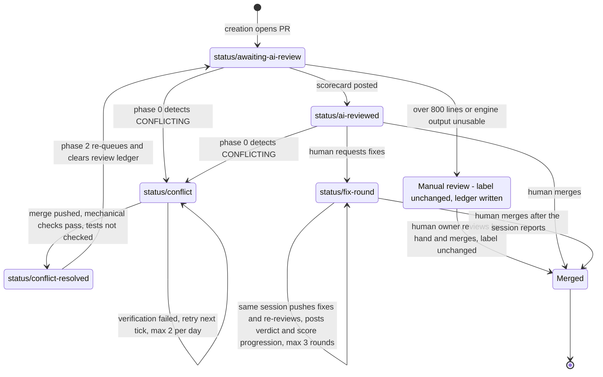
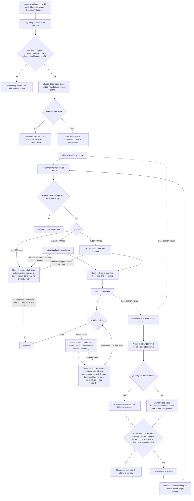

# Software Factory Blueprint

This document describes the autonomous pull-request pipeline that runs around
this repository, and how to reuse it on another project. It covers design,
guards, and lessons learned. It does not describe the `sure-daily-github`
product itself; for that, see the repository `README.md` and `docs/`.

Related sources:

| Source | Role |
|---|---|
| `$H/.hermes/scripts/sdg-*.sh`, `claude-watchdog.sh` | The pipeline. Ground truth when this document and the code disagree. |
| `$H/.hermes/skills/devops/auto-pr-pipeline/SKILL.md` | Operational runbook: manual procedures, pitfalls, recovery steps. |
| `docs/LABELS.md` | Canonical label scheme and `gh` bootstrap commands. |
| `.claude/skills/create-pr/SKILL.md` | Branch name, PR title and PR description template. |

`$H` is the Hermes home on the host (`/home/gerwin/.local/share/hermes-vps`).
All times are Asia/Manila (PHT).

---

## 1. What this is

### Definition

In this document, a **software factory** is a pipeline in which code changes
are created, reviewed, repaired, and re-reviewed by automation, and a person
makes only the merge decision:

```
create -> review -> self-heal -> re-review -> human merge
```

### Fit assessment

The pipeline is a working proof of concept of that definition. It has run
unattended on a schedule since 2026-10-14. As of 2026-10-25, the creation
log records 73 successful creation cycles.

What earns the term:

- **Unattended production.** Cron produces 3 to 10 pull requests a day.
  Each PR is planned, implemented, tested, pushed, and opened by an engine
  without a person starting it.
- **Uniform output.** Branch names, PR titles, PR description sections, and
  labels follow fixed templates. Every PR has the same shape and can be
  processed by the next stage without special cases.
- **A closed repair loop for the most common failure.** When a PR stops
  merging cleanly because its base branch moved, the pipeline detects it,
  repairs it, runs mechanical checks on the pushed result, and sends it back
  for another review. No person is involved. The checks do not include the
  test suite (see the conflict test gate limit below).
- **Throttles on every producer.** A daily plan, a cooldown, a backlog gate,
  a circuit breaker, and review budgets keep output and spending bounded.
- **Toolchain self-maintenance.** A watchdog repairs the engine toolchain
  after host updates remove it.

What is still proof-of-concept grade:

| Limit | Detail |
|---|---|
| Single repository | Every script hardcodes one repository slug, one local clone, and one conflict worktree path. |
| Single assignee | The conflict checker selects PRs assigned to one user. The creation prompt assigns every PR to that user. |
| Hardcoded names | Host paths, the repository, the assignee, the commit identity for clean merges, the base branch for creation (`master`), and the proxy port are literals. A few values have environment overrides. |
| GitHub-specific | State lives in GitHub labels and comments. Detection relies on GitHub's `mergeable` field. All I/O goes through the `gh` CLI. |
| Human merge gate | This is intentional. It also caps throughput at the owner's review bandwidth, which is why the backlog gate exists. |
| Conflict test gate is not enforced by the script | A clean merge is pushed without running the test suite. A conflicted merge depends on the engine following its instruction to run `npm test`. The orchestrator verifies that the push landed, that no conflict markers or attribution remain, and that GitHub reports the PR as mergeable. It does not run the tests or check their results. The PR comment, and the live `status/conflict-resolved` label description defined in `docs/LABELS.md`, say "test suite green", which is stronger than what is actually verified. The bootstrap snippet in section 6 uses wording that claims only what is verified. |
| Review is advisory | Findings are filtered to files the PR changed. They are not checked line by line, and the reviewer does not run the tests. The verdict is a triage signal, not a gate. |
| Status labels can coexist | The conflict checker adds `status/conflict` without removing `status/ai-reviewed` or `status/awaiting-ai-review`. Section 3 defines the precedence rule for reading them. |
| CI is not consulted | No stage reads GitHub check runs. |
| Partial kill switches | Only the review stage has a marker-file kill switch. Creation and conflict repair are stopped by disabling their cron entries. |
| Pipeline scripts have no test suite | Script changes are checked with hand-run fixtures. |
| Observability | Observability is limited to channel messages and per-script log files. There are no metrics. A PR stuck in a deferred state (5.8) produces no notification. |

What separates it from production:

1. **An enforced test gate on every push path.** The product's own
   `fix-conflicts` command (`docs/CONFLICT_FIXER.md`) already does this: it
   pushes only after the repository's tests pass, in an isolated clone, and
   never force-pushes.
2. **CI as the source of truth** for merge readiness, instead of an engine's
   report.
3. **One lifecycle label at a time, enforced by the orchestrator.** The
   product's `pr-maint` command (`docs/PR_MAINTENANCE.md`) removes extra
   lifecycle labels and has a per-PR and global `automation-paused` kill
   switch. It uses its own `sdg:*` label namespace and is not yet wired into
   this pipeline.
4. **Configuration instead of literals**, so that more than one repository,
   assignee, or base branch can be supported.
5. **Tests for the pipeline itself**: fixture tests for every parse chain and
   for every state transition.
6. **Metrics**: PRs per day, review score distribution, conflict repair
   success rate, the rate at which the human overrides the review verdict,
   and time from creation to merge.
7. **An automated merge policy**, if it is ever wanted. The human gate is a
   deliberate choice in this pipeline, not a missing feature.

---

## 2. Architecture

### Jobs

The pipeline consists of four cron entries in the Hermes scheduler. All four
run as `no_agent` jobs: Hermes runs the script directly and delivers its
standard output to the configured destination.

| Schedule | Script | Purpose | Engine | Guards | Delivers to |
|---|---|---|---|---|---|
| `0,30 * * * *` | `sdg-autopr.sh` | Creates one PR per due slot. Claude Code plans, codes, tests, branches, commits, pushes, and opens the PR with label `status/awaiting-ai-review`. The script then checks the result and posts the notification. | Claude Code, `claude-opus-5-5`, under `headroom wrap` | Deterministic daily plan (3 to 10 PRs), 40-minute cooldown, catch-up window closes at 22:30, backlog gate (more than 30 open `auto-pr/*` PRs pauses creation), circuit breaker (3 consecutive failed cycles stops creation for the day), 60 turns, 30-minute timeout, run lock and repo lock, attribution audit after the cycle | Review channel |
| `5,35 * * * *` | `sdg-conflict-patrol.sh` | Phase 0 labels conflicting PRs. Phase 1 resolves them. Phase 2 sends resolved PRs back for review. | `git merge` when the merge is clean. Otherwise Claude Code, `claude-opus-5-5`, under `headroom wrap`. | 2 attempts per PR per day, `UNKNOWN` mergeability deferred to the next tick, repo lock, orchestrator verification, 40 turns, 25-minute timeout | Review channel |
| `20,50 * * * *` | `sdg-autoreview.sh` | Reviews each PR labeled `status/awaiting-ai-review` on an `auto-pr/*` branch, posts one scorecard comment, and changes the label to `status/ai-reviewed`. | `claude-haiku-5-5` (`claude -p`) for diffs of 400 lines or fewer. `openai/gpt-6.1-sol` (OpenCode) for 401 to 800 lines. | One review per PR until a conflict repair clears its ledger entry, 10 reviews per day, 2 per tick, diffs over 800 lines skipped, 60,000-character input cap, kill switch, run lock | Review channel |
| `25,55 * * * *` | `claude-watchdog.sh` | Repairs the toolchain: the node symlink, the `claude` CLI (reinstall, plus an update check at most every 20 hours), `headroom` with its proxy extras and launcher, and the `opencode` symlink. | None. Uses no tokens. | Silent when healthy | Owner's direct messages |

The jobs are staggered so that they rarely overlap. The watchdog runs five
minutes before each creation tick, so a broken toolchain is repaired before
the job that relies on it most.

### Engine routing

| Role | Engine and model | Input | Cost basis |
|---|---|---|---|
| Implementation | Claude Code, `claude-opus-5-5` | The whole repository. The engine explores, edits, and runs tests. | Subscription |
| Conflict resolution | Claude Code, `claude-opus-5-5` | Worktree with a merge in progress | Subscription. Runs only when `git merge` cannot finish on its own. |
| Review, 400 diff lines or fewer | `claude -p`, `claude-haiku-5-5`, 4 turns, `Read` tool only | The diff and the PR title and body only | Subscription, so no per-token cost |
| Review, 401 to 800 diff lines | OpenCode, `openai/gpt-6.1-sol` | The diff and the PR title and body only | Metered: $2 per million input tokens and $10 per million output tokens |
| Review fallback | `claude -p`: Haiku for 400 lines or fewer, Opus for more | Same | Subscription |
| Review, more than 800 diff lines | None. The PR is skipped with a note. | None | None |

The routing follows from where open-ended reasoning is needed:

- **Implementation is unbounded.** The engine has to choose a change, read the
  code, edit several files, and get the tests to pass. The strongest model is
  used here, and the run is capped by turns and wall-clock time.
- **Review is bounded by the diff.** For a small diff, a small model with no
  repository access is enough to find correctness, edge-case, security, and
  missing-test issues.
- **Large diffs go to a stronger metered model**, under a line cap and a
  character cap. The caps bound the input of one review, not its total cost.
  An illustrative estimate for one successful metered review: at about
  4 characters per token, 60,000 characters of diff plus a 3,000-character
  description is roughly 16,000 input tokens, or about $0.03. A typical
  output is a JSON findings list of a few thousand tokens, or a few cents.
  Ten such reviews a day come to well under $1. This is an estimate, not a
  measured bill, and not a bound: the daily and per-tick counters count only
  successful reviews, a failed metered attempt is still billed, and nothing
  caps the engine's output tokens. A hard daily bound would require counting
  attempts rather than successes against the budget, and capping output
  tokens or spend on the metered engine.
- **Speed tiers are never used** (`-fast`, `-ultrafast`). They cost more per
  token, not less (see incident 5.5). Batch review has no latency requirement.
- **A fallback must reset the model ID.** If the OpenCode run fails, the
  Claude fallback picks a Claude model. It never passes an OpenAI model ID to
  the Claude CLI.

Both Claude Code launches go through `headroom wrap`, a context-compression
proxy, on a dedicated port (`HEADROOM_PORT=8789`). The port must be set on
every launch. The proxy process is stopped after each run, because a leftover
proxy holds about 700 MB of memory.

### Concurrency and isolation

| Lock | Held by | Protects |
|---|---|---|
| `$H/.autopr-sdg/lock` | Creation | Prevents two creation cycles from running at once. |
| `$H/.autopr-sdg/repo.lock` | Creation and conflict repair | The shared clone. Creation runs `git checkout master` and `git reset --hard origin/master` in it. Conflict repair adds and removes a linked worktree from it. |
| `$H/.autopr-sdg/autoreview/lock` | Review | Prevents two review ticks from running at once. Review never touches a checkout (it uses `gh` only), so it does not take the repo lock. |

All locks are non-blocking (`flock -n`). A busy lock makes the tick exit and
leaves the work to the next tick. It never queues behind the other job.

Worktree isolation:

- **Conflict repair** creates a dedicated linked worktree for each PR it
  processes and removes it afterwards. A fresh worktree has no `node_modules`,
  so the script runs `npm ci` before any tests.
- **Creation** works in the primary clone after a hard reset to
  `origin/master`. The repo lock keeps it from interfering with conflict
  repair.
- **Manually started jobs** (feature implementation, review and fix rounds,
  documentation) each get their own worktree on their own branch. They never
  share a checkout with each other or with the cron jobs.

### State on disk

| Path under `$H/.autopr-sdg/` | Meaning |
|---|---|
| `run.log` | Creation log. Its `ok:` lines are the authoritative daily quota count. |
| `last_pr_ts` | Time of the last successful PR. Used for the cooldown. |
| `daydone-<date>` | The daily summary has been posted for this date. |
| `fail_streak`, `fail_day`, `circuit-<date>` | Circuit breaker state. |
| `claude-<date>-<idx>.txt`, `fixconf-<pr>-<ts>.txt` | Engine transcripts for each cycle. Deleted after 14 days. |
| `autoreview/done-<pr>` | Review ledger. Its presence means "do not review again". |
| `autoreview/count-<date>` | Number of successful reviews that day. |
| `conflict-patrol/pr-<n>/{date,attempts}` | Conflict-repair attempts per PR per day. |
| `review-off` | Review kill switch. Review is disabled while this file exists. |

### Notification design

Hermes delivers whatever a `no_agent` script prints to standard output, and
delivers nothing when the output is empty. The pipeline builds on that:

- **One message per unit of work.** Units of work are: a PR created, a PR
  reviewed, a conflict-label transition, a failed cycle, a toolchain repair,
  and the daily summary.
- **Standard output is the only delivery path.** A script never sends to a
  channel itself. Two paths to the same channel caused every message to be
  posted twice (incident 5.1).
- **Idle ticks print nothing.** Nothing printed means nothing delivered.
- **Silence is made unambiguous.** Because an idle tick and a dead job look
  the same, creation posts exactly one summary per day: "day complete" when
  the plan is done, or "day ended short" when the window closes before the
  plan is done. The summary includes the backlog and the next day's plan.
- **A failure message carries the cause.** It includes the last few lines of
  the engine transcript, not only a log path, so diagnosing it does not
  require a shell session on the host.

---

## 3. The PR state machine

State is held in `status/*` labels on the PR (see `docs/LABELS.md`). Those
labels are owned by the automation. People read them and do not set them.
They describe where the automation stands with a PR, not whether the PR may
be merged.

### States

| State (label) | Owner | Entry condition | Exit transitions | Guards |
|---|---|---|---|---|
| `status/awaiting-ai-review` | Bot (review) | Creation opens the PR with this label. Conflict repair Phase 2 re-adds it after a repair. | Becomes `status/ai-reviewed` once the scorecard comment has been posted. Otherwise stays with a ledger entry written and needs manual review: diff over 800 lines (`skipped-size`), or no engine produced usable output (`failed`). The human owner reviews such a PR by hand and may merge it; its label stays `status/awaiting-ai-review`. | Ledger `done-<pr>`, 10 per day, 2 per tick, 800-line cap, 60,000-character cap, kill switch. Only `auto-pr/*` head branches are picked up. |
| `status/ai-reviewed` | Human | The review posted its scorecard. | Human merges, which ends the lifecycle. Human asks for fixes, which leads to `status/fix-round`. Phase 0 sees `CONFLICTING` and adds `status/conflict`. | Human merge gate. No automated exit to merged. |
| `status/conflict` | Bot (conflict repair) | Phase 0: the PR is open, assigned to the owner, `mergeable` is `CONFLICTING`, and it has neither `status/conflict` nor `status/conflict-resolved`. | Becomes `status/conflict-resolved` once a repair passes verification, or once the PR is found to be no longer `CONFLICTING`. Stays when verification fails, until the next tick. Stays when the attempt cap is reached, until the next day or a human acts. | 2 attempts per PR per day (clean merges count as attempts), `UNKNOWN` deferred, repo lock, verification: push landed, no attribution in the last commit, no conflict markers, GitHub reports neither `CONFLICTING` nor `UNKNOWN`. |
| `status/conflict-resolved` | Bot (conflict repair) | Phase 1 succeeded: the branch was merged with its base and passed the mechanical checks listed above. The label does not mean the tests passed. | Phase 2 replaces it with `status/awaiting-ai-review` and deletes `autoreview/done-<pr>`, so the merged result gets reviewed again. | Phase 0 skips PRs with this label, so they cannot be relabeled in a loop. |
| `status/fix-round` | Bot (manually started fix session) | A human asks for the review findings to be addressed. No cron job sets this label. | Fixes are pushed (one commit per finding). The same manually started session then re-reviews the PR (a session-scoped review, not the cron reviewer) and posts each verdict and the score progression to the PR. The PR then returns to the human merge decision. No cron job reads or clears this label, and fix rounds leave the cron review ledger `done-<pr>` untouched, so the cron reviewer does not review the fixed code. | At most 3 review-and-fix rounds. At the cap the session stops and offers three options: run one more targeted round, merge with a tracking issue for what remains, or hold. |
| Merged or closed | Human | Explicit human action | None (end of lifecycle) | Merge commits only (`gh pr merge --merge`). Merges happen only on explicit request. |

**Coexistence and precedence.** Labels are added and removed, not replaced
as a single field, so a PR can carry more than one `status/*` label. For
example, a reviewed PR that later conflicts carries both `status/ai-reviewed`
and `status/conflict`. Read the current state with this precedence:

```
conflict > conflict-resolved > fix-round > awaiting-ai-review > ai-reviewed
```

**Merge permission.** Lifecycle labels reflect automation state, not merge
permission. The human owner may merge any PR at any time, whatever its
labels say. `status/ai-reviewed` as the sole `status/*` label means only
that the automation has finished with the PR in its current code state and
posted a scorecard.

**Manual review.** When the cron reviewer skips a PR (diff over 800 lines)
or gets no usable output from any engine, it writes the ledger entry
`done-<pr>` and leaves the label at `status/awaiting-ai-review`. The owner
reviews the PR by hand and merges it, or not, without changing the label.
The ledger entry blocks only the cron reviewer from picking the PR up again.
Nothing else reads it: conflict repair, merging, and manual sessions ignore
it. If the PR later conflicts, conflict repair Phase 2 deletes the entry as
usual, and the cron reviewer tries again on the merged result.

### Label lifecycle



### Factory pipeline



---

## 4. Token frugality

**Principle: automation multiplies tokens. Every automated path needs a
budget and an off switch.** A manual prompt costs tokens once. A cron entry
that runs every 30 minutes can spend them 48 times a day, indefinitely, and
a bug in a loop spends them faster. Each stage of the pipeline therefore
bounds the cost of a single run, the number of runs, and the total, and has
a way to be stopped.

| Control | Stage | Mechanism | Effect |
|---|---|---|---|
| Diff-scoped input | Review | The engine receives only the PR title, up to 3,000 characters of description, and the diff. It runs in an empty temporary directory with the `Read` tool only. | Review cost depends on the diff size, not the repository size. |
| Input cap | Review | Diff truncated to 60,000 characters. Null bytes stripped. | Bounds the input of a single review. |
| Line cap | Review | Diffs over 800 lines are skipped with a note. | The most expensive reviews go to the human. |
| Model routing | Review | Haiku (subscription) for 400 lines or fewer. Standard Sol (metered) for larger diffs. Never a speed tier. | Most reviews have no per-token cost. |
| One-review ledger | Review | `done-<pr>` is written after a review, a size skip, or an engine failure. Only a conflict repair deletes it. | The cron reviewer reviews a PR once, and again only after a conflict repair, not once per tick. Fix-round commits change the code without clearing the entry. Their re-review happens inside the fix session, not in cron. |
| Daily and tick budgets | Review | 10 successful reviews per day, 2 per tick. | Limits successful reviews per day and per tick. Failed attempts are not counted (see known gaps). |
| Kill switch | Review | `touch $H/.autopr-sdg/review-off` disables review. `rm` re-enables it. | Immediate stop without editing cron. |
| Daily plan | Creation | 3 to 10 PRs per day, seeded by the date. Slots are drawn between 08:00 and 21:00. | Fixed upper bound on implementation runs. |
| Cooldown and window | Creation | At least 40 minutes between PRs. Catch-up stops at 22:30. | No bursts after downtime. |
| Backlog gate | Creation | No new PR while more than 30 `auto-pr/*` PRs are open. | Creation cannot outrun the human. |
| Circuit breaker | Creation | 3 consecutive failed cycles stop creation for the rest of the day. `FORCE_SLOT=1` overrides it. | A broken environment does not spend a model run every 30 minutes. |
| Turn and time caps | Creation, conflict repair | 60 turns and 30 minutes, or 40 turns and 25 minutes. | Bounds a single run. |
| LLM only when needed | Conflict repair | A clean `git merge` is pushed without an engine. | Most conflict repairs spend no tokens. |
| Attempt cap | Conflict repair | 2 attempts per PR per day. | An unresolvable conflict cannot loop. |
| Context compression | Creation, conflict repair | `headroom wrap` proxy. A global shell-output reduction hook is also active. | Fewer tokens per turn on long runs. |

Known gaps:

- The daily and per-tick review counters count only successful reviews. An
  engine failure is recorded in the ledger, so it never repeats, but one tick
  can attempt more than two PRs if earlier attempts in that tick failed, and
  a failed metered attempt is billed without consuming the budget.
- The metered review engine has no output-token or spend cap. Review cost
  estimates (section 2) are illustrative, not bounds.
- Creation and conflict repair have no marker-file kill switch. They are
  stopped by disabling their cron entries.

---

## 5. Learnings (incident log)

Each incident is recorded with what happened, its root cause, and the
permanent fix. The fixes are encoded either in the scripts or in the
invariants in section 6.

### 5.1 Duplicate notifications

- **What happened.** Every created PR was announced twice in the review
  channel: one formatted message and one "Cronjob Response" echo.
- **Root cause.** The creation script sent its message with `hermes send`
  and also printed it to standard output. The cron entry delivers standard
  output to the same channel. There were two delivery paths into one channel.
- **Permanent fix.** Messages go to standard output only. The scripts carry a
  comment that forbids `hermes send`. The invariant is one delivery path per
  job.

### 5.2 Headroom proxy dependencies wiped while the health check stayed green

- **What happened.** Every `headroom wrap` launch failed immediately with
  "Proxy dependencies not installed" / `No module named 'fastapi'`. The
  watchdog still reported the toolchain as healthy.
- **Root cause.** A Hermes update re-provisioned its tools Python directory.
  The proxy extras were installed only in that directory, so they were
  deleted. The `headroom` CLI itself imports from the persistent `$H/.local`
  prefix, so the watchdog's `headroom --version` check kept passing. The
  check did not exercise the code path the pipeline actually uses.
- **Permanent fix.** The watchdog checks `import fastapi` with the pipeline's
  `PYTHONPATH`. When the import fails, it reinstalls `headroom-ai[proxy]`
  into the persistent prefix and rewrites the launcher. Manual verification
  is a real `HEADROOM_PORT=8789 headroom wrap claude -p ...` run, not
  `--version`.

### 5.3 pip install replaced the custom headroom launcher

- **What happened.** After a reinstall, the pipeline's `headroom` failed with
  `ModuleNotFoundError: No module named 'headroom'`.
- **Root cause.** `pip install --prefix $H/.local` writes its own console
  script to `$H/.local/bin/headroom`. That script is a bare Python shim
  without the `PYTHONPATH` the custom launcher sets, and it overwrote the
  launcher. An interactive shell could still find a different, working
  `headroom` elsewhere on its `PATH`, which hid the problem.
- **Permanent fix.** The watchdog rewrites the launcher after every pip
  install, in every reinstall branch. Verification runs
  `$H/.local/bin/headroom` by absolute path in a shell with a minimal `PATH`.

### 5.4 Control-character separator parsed by sed but not by grep

- **What happened.** The review scorecard comment on the PR was correct, but
  the channel notification for the same review had empty score, count, and
  verdict fields.
- **Root cause.** Metadata was passed in-band using a `\x01` separator. GNU
  `sed` interprets `\x01` and correctly stripped the metadata from the
  comment. GNU `grep` with a basic regular expression treats it as literal
  text, so the metadata extraction matched nothing.
- **Permanent fix.** A plain-text marker line (`===META=== score crit warn
  verdict`) is matched with `grep '^===META==='`. Fixture tests cover the
  whole parse chain (scorecard, then metadata, then notification string),
  not just the step that produces the output.

### 5.5 Speed-tier pricing inversion

- **What happened.** An early routing design sent small diffs to a `-fast`
  variant of the review model, on the assumption that faster meant cheaper.
- **Root cause.** The tier names describe latency, not cost.
  `gpt-6.1-sol-fast` costs twice the standard price and `-ultrafast` six
  times. Batch review has no latency requirement, so the premium bought
  nothing.
- **Permanent fix.** Review routes only to standard `openai/gpt-6.1-sol` or
  to subscription-covered Claude models. The script header records the rule.
  Before routing to any model, check its price per token, not its name.

### 5.6 `python3 -` argument off-by-one

- **What happened.** A posted scorecard showed the path of `findings.json`
  where the PR number should have been (PR #46).
- **Root cause.** When a script is fed to `python3 -` from a here-document,
  `sys.argv[0]` is `-`. The first real argument is `argv[1]`. The scorecard
  builder was off by one.
- **Permanent fix.** The indexing was corrected. After any change to argument
  indexing, a fixture run of the builder is required.

### 5.7 Abort after side effects but before the ledger write

- **What happened.** The review script aborted after it had posted the
  scorecard comment and changed the label, but before it wrote
  `done-<pr>`. The PR was left without a ledger entry, so the one-review
  guarantee no longer held for it.
- **Root cause.** `set -u` combined with a variable-name case mismatch
  (`$engine` vs `$ENGINE`) raised an unbound-variable error midway through
  the sequence: comment, then label, then ledger.
- **Permanent fix.** The variable was corrected. Operating rule: after any
  mid-run abort, reconcile the ledgers with the labels. Every PR labeled
  `status/ai-reviewed` must have `autoreview/done-<pr>`, and any missing
  entries are written by hand. A structural improvement for new projects is
  to write an in-progress ledger entry before the first external side effect.

### 5.8 GitHub label-index lag

- **What happened.** A PR labeled `status/conflict` in Phase 0 did not
  appear in Phase 1's `--label status/conflict` query in the same tick. The
  same lag applies between Phase 1 and Phase 2.
- **Root cause.** Label-filtered PR listing is served from an index that
  lags label writes. The same applies to `mergeable`, which reads `UNKNOWN`
  for a while after a push.
- **Permanent fix.** Every phase is idempotent and converges over successive
  ticks. Not finding a PR yet is never treated as a failure, and `UNKNOWN` is
  deferred. In practice a deferred transition typically resolves within one
  or two ticks (observed, not guaranteed; GitHub does not bound the lag).
  After a push, verification waits about 10 seconds before reading
  `mergeable`.
- **Detecting persistent deferral.** A transition that is stuck rather than
  lagging shows up as a PR whose `mergeable` stays `UNKNOWN`, or a labeled PR
  that the next tick's label query does not return, across multiple
  consecutive ticks. The intended detection mechanism reuses the creation
  job's failure-streak pattern (`fail_streak`): count consecutive ticks
  without progress per PR, and after 3 such ticks notify the owner once.
  Conflict repair does not implement this counter yet. Until it does, a stuck
  PR is visible only in the patrol log.

### Other recorded pitfalls

| Pitfall | Rule |
|---|---|
| The daily quota was counted from GitHub and included PRs from other pipelines (the log showed `14/10`). | Count a job's output from its own success log lines. Use GitHub only as a fallback. |
| An "end of window" guard placed at the last slot silently turned every catch-up cycle into a no-op. | Close the window well after the last slot (22:30), and replay the historical log against any new guard before shipping it. |
| Two jobs drove the same clone under two different locks. | Shared mutable checkouts sit behind one shared lock (`repo.lock`). |
| `pkill -f 'headroom.cli proxy'` matched and killed its own shell. | Use a character class in the pattern: `prox[y]`. |
| `headroom wrap` without `HEADROOM_PORT` fell back to a stale proxy that could not be killed, and the run aborted. | Set the port in the same command on every launch. |
| Null bytes in diffs corrupted command substitutions. | Run `tr -d '\000'` before embedding a diff in a prompt. |
| `npm test` failed in a fresh worktree with errors that looked like regressions. | Run `npm ci` first. A new worktree has no `node_modules`. |
| A placeholder email in commit identity broke GitHub account linkage. | Check author and committer identities before every push. |
| Pushes touching `.github/workflows/**` were rejected. | The `gh` token needs the `workflow` scope. Grant it once with `gh auth refresh -s workflow`. |

---

## 6. Adapting this blueprint to a new project

### Parameters

| Parameter | Current value | Where it is set today |
|---|---|---|
| Hermes home | `/home/gerwin/.local/share/hermes-vps` | `H=` in all four scripts and in the headroom launcher |
| Repository | `iamgerwin/sure-daily-github` | `R=` in all three `sdg-*` scripts |
| Local clone and conflict worktree | `$H/Developer/_personal/sure-daily-github`, `.../wt-conflict` | `REPO=`, `WT=` |
| Assignee | `iamgerwin` | Creation prompt (`--assignee`), Phase 0 filter, notification text |
| Clean-merge commit identity | Owner's name and email | Phase 1 `git -c user.name=... -c user.email=...` |
| Base branch | `master` for creation. Conflict repair reads each PR's `baseRefName`. | Creation reset, prompt, and `--base` |
| Branch prefix | `auto-pr/` | Creation, review filter, backlog gate, `create-pr` skill |
| Time zone and window | Asia/Manila. Slots 08:00 to 21:00, catch-up until 22:30. | `TZ=`, plan generator, `SDG_AUTOPR_WINDOW_CLOSE_MIN` |
| Creation volume | 3 to 10 per day, 40-minute cooldown | Plan generator, `2400` literal |
| Backlog gate and breaker | 30 open PRs, 3 failures | `SDG_AUTOPR_MAX_OPEN`, `SDG_AUTOPR_MAX_FAILS` |
| Implementation model | `claude-opus-5-5` | `SDG_AUTOPR_MODEL`. The conflict model is a literal. |
| Review engines and models | Haiku up to 400 lines, Sol above | `SDG_REVIEW_ENGINE`, `SDG_REVIEW_MODEL`. The 400-line threshold is a literal. |
| Review budgets | 10 per day, 2 per tick, 800 lines, 60,000 characters | `SDG_REVIEW_MAX_DAY`, `SDG_REVIEW_MAX_LINES`. Tick and character caps are literals. |
| Test command | `npm test` (after `npm ci`) | Engine prompts, conflict repair |
| Proxy port | `8789` | `SDG_AUTOPR_PORT` in creation. A literal in conflict repair. |
| Notification channel | Review channel for the three `sdg-*` jobs. Direct messages for the watchdog. | Each Hermes cron entry's `deliver` field |

### Bring-up checklist

Enable consumers before producers, so that nothing is created that cannot
yet be reviewed or repaired.

1. **Labels.** Create the label families from `docs/LABELS.md`. The
   bootstrap there renames legacy labels with `gh label edit`. On a new
   repository those legacy names do not exist, so create the `status/*`
   labels directly:
   ```bash
   R=<owner>/<repo>
   for l in \
     "status/awaiting-ai-review:FBCA04:Bot-owned: PR created, queued for automated diff review (scorecard). Next: status/ai-reviewed." \
     "status/ai-reviewed:1D76DB:Bot-owned: AI scorecard posted (verdict, mergeability, findings). Awaiting human merge decision." \
     "status/conflict:D73A4A:Bot-owned: merge conflict detected; automated resolution in progress (max 2 attempts/day)." \
     "status/conflict-resolved:0E8A16:Bot-owned: conflict auto-resolved, branch merged with base; re-queuing for AI review." \
     "status/fix-round:A62D03:Bot-owned: automation is working through AI review findings on this PR; one commit per finding."; do
     IFS=: read -r n c d <<<"$l"; gh label create "$n" -R "$R" --color "$c" --description "$d" --force
   done
   ```
   Then run the `type/*` and `priority/*` loop from `docs/LABELS.md`. Use
   `gh label create --force` for `type/bug`, `type/feature`, and `type/docs`
   if the repository's default labels have been removed.
2. **Repository rules.** Copy `CLAUDE.md` (the no-attribution rule and test
   command) and `.claude/skills/create-pr/SKILL.md` (branch name, title, and
   description template) into the new repository and adjust the test
   command.
3. **Parameters.** Set every value in the table above. Search the scripts
   for the old repository slug, assignee, and paths. No literal from this
   project may remain.
4. **Watchdog.** Enable it first and confirm that a run on a healthy host
   prints nothing.
5. **Review.** Create the kill-switch file, enable the cron entry, open one
   PR by hand with `status/awaiting-ai-review`, remove the kill switch, and
   confirm that exactly one scorecard and one notification appear.
6. **Conflict repair.** Enable it. Create a deliberate conflict on a test PR
   and follow it through `status/conflict`, `status/conflict-resolved`, and
   `status/awaiting-ai-review`. Confirm that the review ledger was cleared and
   a second scorecard was posted.
7. **Creation.** Enable it last, with a small plan and a low backlog gate.
   Confirm the daily summary at the end of the first day.

### Invariants

These properties carry the design. Do not change them when adapting the
pipeline.

| Invariant | Reason |
|---|---|
| One notification per unit of work, through one delivery path | Duplicate or missing messages make the channel useless as a monitor (5.1). A daily summary keeps silence meaningful. |
| Every automated path has a budget and an off switch | Automation multiplies tokens. A path without a cap is a cost incident waiting to happen. |
| Phases are idempotent and converge over ticks | GitHub state is eventually consistent (5.8). Re-running a tick must never change labels back and forth or repeat paid work. Phase 0 must keep excluding in-flight labels. |
| Engine self-reports are verified | Check that the push landed, that HEAD matches the remote, that there are no conflict markers or attribution, that GitHub reports the PR as mergeable, and, in a production version, that the tests passed. "Done" from an engine is a claim, not a result. |
| A human makes the merge decision | Review is diff-scoped and advisory. A `critical` verdict means "check this manually", not "this is true". |
| Zero AI attribution | Enforced in three places: the engine prompts, the `includeCoAuthoredBy:false` setting on conflict-repair runs, and creation's audit after the push, which strips trailers and cleans the PR title and body. Conflict repair rejects any commit message that mentions attribution. |
| `status/*` labels are owned by the automation | Humans read lifecycle labels and do not set them. Otherwise the state machine cannot reason about them. The labels describe automation state, not merge permission: the owner may merge any PR at any time. |
| Engine input is bounded | Review sees the diff and description, never the repository. Every input has a cap. |
| Shared checkouts sit behind one lock, and every other job has its own worktree | Two jobs in one checkout destroy each other's work. |

### Change policy

The label scheme, this blueprint, the label documentation, and the scripts
form one contract.

- Change them only on explicit request from the repository owner, never as
  an incidental cleanup.
- When one changes, update all of them in one atomic pass: the GitHub labels,
  `sdg-autopr.sh`, `sdg-autoreview.sh`, `sdg-conflict-patrol.sh`,
  `.claude/skills/create-pr/SKILL.md`, `docs/LABELS.md`, this document, and
  the runbook.
- Before shipping a change to a guard, replay the historical logs against it
  to see what it would have blocked or allowed.
- When this document and the scripts disagree, the scripts describe what the
  pipeline actually does. Fix whichever one is wrong, in the same pass.
